##  {#title-slide background="images/tree_bg.png" background-size="40%"}

::: title-box
<h2>

Diversity and Trait-Based Approaches

</h2>

<h3>
🧑🏻‍💻 [Masatoshi Katabuchi \@ XTBG, CAS]{.author}


<div style="overflow: hidden; height: 1.2em;">
<ul class="content__container__list center" style="text-align: center">
<li class="content__container__list__item"><i class="fa-solid fa-envelope"></i> mattocci27@gmail.com</li>
<li class="content__container__list__item"><i class="fa-brands fa-bluesky"></i> <a href="https://bsky.app/profile/mattocci.bsky.social">mattocci.bsky.social</a></li>
<li class="content__container__list__item"><i class="fa-brands fa-github"></i> github.com/mattocci27/phy-fun-div</li>
<li class="content__container__list__item"><i class="fa-solid fa-globe"></i> https://mattocci27.github.io</li>
</ul>
</div>
</h3>
:::


<br><br>

::: {.absolute .top-0 .w-100}
[November 18-20, 2025]{.fl} [XTBG AFEC]{.fr}
:::


::: notes


:::
---

## Objective

::: large
We Learn:

- Why we use functional and phylogenetic diversity

- How to calculate functional and phylogenetic diversity

- Trait-based approaches
:::

<!--  -->

---

## Outline

::: large
- Community Ecology

- Simple diversity indices

- Phylogenetic diversity

- Functional traits and diversity

- R examples
:::

---

## Community Assembly and Species Coexistence

For over a century, field ecologists have been characterizing patterns in ecological communities and trying to draw theoretical inferences from the resulting data.

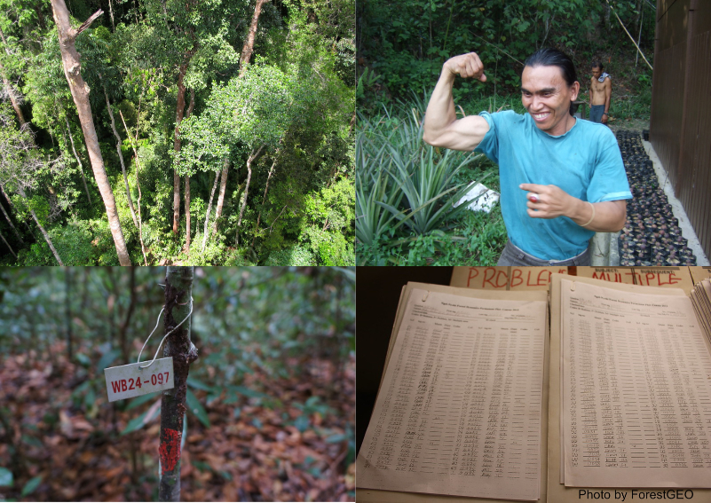

---

## Central Questions:

::: columns
::: {.column width="50%"}
::: small
- Why do species occur in specific locations?

- Why do some species coexist while others do not?

::: incremental

- **Environmental filtering**:
  - [**Ecologically similar**]{.blue} species should coexist in ecologically similar environments.
- **Limiting similarity**:
  - [**Ecologically dissimilar**]{.orange} species should coexist because too similar species competing for the same resources cannot stably coexist.
- **Neutral theory**:
  - Dispersal and stochastic demographic processes explain species coexistence and species differences are not important.

:::
:::
:::

::: {.column width="50%"}
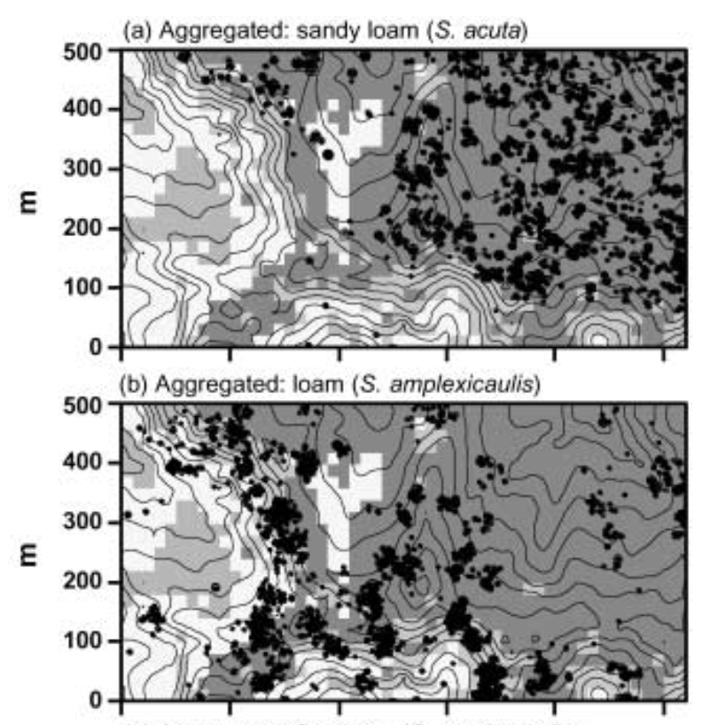
:::
:::


::: footer
Russo et al. 2005, Journal of Ecology.
:::

---

## How can we quantify ecological similarity of coexisting species?

---

## How to quantify ecological communities 🍃


::: large
::: incremental

- Species

- Species + Site information (1950s ~)

- Species + Site information + Species information (2000s ~)

:::
:::

::: notes
The dates indicate approximately when these approaches became widely used in community ecology, not when the underlying research first began.

:::
---

## 1a) First-order properties: abundance

::: footer
[1] Vellend, M. (2016). The Theory of Ecological Communities. Princeton University Press
:::


::: columns
::: {.column width="50%"}
- A **vector** of species abundance

- Species composition


::: {.cell layout-align="center"}
::: {.cell-output-display}
`````{=html}
<table class=" lightable-material lightable-striped lightable-hover" style='font-size: 28px; font-family: "Source Sans Pro", helvetica, sans-serif; width: auto !important; margin-left: auto; margin-right: auto;'>
 <thead>
  <tr>
   <th style="text-align:left;">   </th>
   <th style="text-align:right;"> Site1 </th>
  </tr>
 </thead>
<tbody>
  <tr>
   <td style="text-align:left;"> Sp. 1 </td>
   <td style="text-align:right;"> 4 </td>
  </tr>
  <tr>
   <td style="text-align:left;"> Sp. 2 </td>
   <td style="text-align:right;"> 300 </td>
  </tr>
  <tr>
   <td style="text-align:left;"> Sp. 3 </td>
   <td style="text-align:right;"> 56 </td>
  </tr>
  <tr>
   <td style="text-align:left;"> Sp. 4 </td>
   <td style="text-align:right;"> 23 </td>
  </tr>
</tbody>
</table>

`````
:::
:::


::: {.cell layout-align="center"}
::: {.cell-output-display}
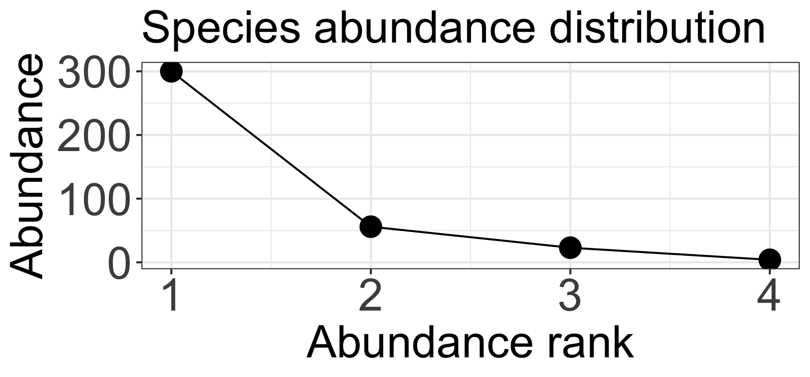{fig-align='center' width=576}
:::
:::


:::

::: {.column width="50%"}
::: fragment
- Species richness = 4
:::

::: fragment
- Inverse Simpson diversity


::: {style="font-size: 0.75em; line-height: 1.25; margin-top: 0.3em;"}
$$
\begin{aligned}
\Sigma p_i^2 &= (4/383)^2 + (300/383)^2 \\
            &\quad + (56/383)^2 + (23/383)^2 \approx 0.639 \\[0.6em]
1/\Sigma p_i^2 &= 1/0.639 \approx 1.57
\end{aligned}
$$
:::
:::

:::

:::

::: notes
$p_i$ is the relative abundance of species i (for example, $p_2$ = 300/383). Taking the reciprocal gives an effective number of species: how many equally abundant species would produce the same value? Four equally abundant species give 4; a single species gives 1. Here, Sp. 2 dominates, so the value is only about 1.57 despite a species richness of 4. The next two slides derive the underlying expression.

:::
---

## 1a) First-order properties: drawing the same species

::: footer
[1] Vellend, M. (2016). The Theory of Ecological Communities. Princeton University Press
:::

Which community is more diverse?

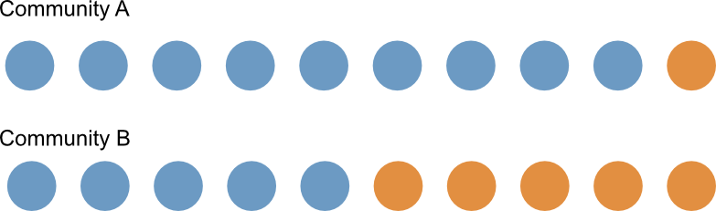

::: columns
::: {.column width="50%"}
::: fragment
- Species richness = 2

- What is the chance to get the same species?
:::
:::

::: {.column width="50%"}
::: fragment
- A: $\frac{9}{10} \times \frac{8}{9} + \frac{1}{10} \times \frac{0}{9} = 0.8$

- B: $\frac{5}{10} \times \frac{4}{9} + \frac{5}{10} \times \frac{4}{9}  \simeq 0.44$
:::
:::
:::

---

## 1a) First-order properties: Simpson's index

::: columns
::: {.column width="50%"}
Which community is more diverse?


- A: $\frac{9}{10} \times \frac{8}{9} + \frac{1}{10} \times \frac{0}{9} = 0.8$


- B: $\frac{5}{10} \times \frac{4}{9} + \frac{5}{10} \times \frac{4}{9}  \simeq 0.44$

- We prefer that large values indicate more diverse communities.
:::

::: {.column width="50%"}
::: fragment
- Diversity of A: 1 - 0.8 = 0.2

- Diversity of B: 1 - 0.44 = 0.56
:::
::: fragment
- Simpson's Index of Diversity:
  $D = 1 - \Sigma\frac{n_i(n_i - 1)}{N(N - 1)}$


- Simpson's Index of Diversity (large *N*):
  $D = 1 - \Sigma p_i^2$
:::
:::
:::

::: footer
*n*: number of individuals of each species,
*N*: total number of individuals of all species,
*p*: relative species abundance

[1] Vellend, M. (2016). The Theory of Ecological Communities. Princeton University Press
:::

::: notes
The calculation on the left draws two individuals from a total of ten without replacement. $1-\Sigma p_i^2$ describes sampling with replacement; the two expressions converge as N increases. In this ten-individual example, the latter gives 0.18 for A and 0.50 for B, slightly different from the values of 0.20 and 0.56 above.

:::
---

## 1a) First-order properties: Shannon's index


::: columns
::: {.column width="45%"}
Another simple way to describe diversity?


::: incremental
::: small
- A: $p_1$ = 0.9, $p_2$ = 0.1

- B: $p_1$ = 0.5, $p_2$ = 0.5

- Diversity of A: 0.9 $\times$ 0.1 = 0.09?

- Diversity of B: 0.5 $\times$ 0.5 = 0.25?

- Diversity $\times$ Diversity? What is the unit?

:::
:::
:::

::: {.column width="55%"}
::: small
::: fragment
- $\mathrm{log}(x \times y) = \mathrm{log}(x) + \mathrm{log}(y)$
:::

::: fragment
- Expectations:
  - A: $0.9 \times \mathrm{log}(0.9) + 0.1 \times \mathrm{log}(0.1) \simeq -0.32$
  - B: $0.5 \times \mathrm{log}(0.5) + 0.5 \times \mathrm{log}(0.5) \simeq -0.69$
:::

::: fragment
- We prefer that large values indicate more diverse communities.
  - A: $-1 \times (-0.32) = 0.32$
  - B: $-1 \times (-0.69) = 0.69$
:::
::: fragment
- Shannon Diversity Index: $H' = -\Sigma p_i\mathrm{log}p_i$
:::
:::
:::
:::

::: footer
*p*: relative species abundance

[1] Vellend, M. (2016). The Theory of Ecological Communities. Princeton University Press
:::


::: notes
- If we use log, multiplication becomes an addition.

- Expectations to get a particular species (abundance weighted)

- $-\log p_i$ is the "surprise" associated with drawing species i. Rarer species produce greater surprise. H' is the average surprise, weighted by the occurrence probability $p_i$.

- The mathematical theory of communication (0 or 1 data)

:::
---

## 1b) First-order properties of multiple communities (Beta diversity){.small}

::: footer
[1] Vellend, M. (2016). The Theory of Ecological Communities. Princeton University Press
:::

::: columns
::: {.column width="50%"}
- Species $\times$ site **matrix**
- Metacommunity


::: {.cell layout-align="center"}
::: {.cell-output-display}
`````{=html}
<table class=" lightable-material lightable-striped lightable-hover" style='font-family: "Source Sans Pro", helvetica, sans-serif; margin-left: auto; margin-right: auto;'>
 <thead>
  <tr>
   <th style="text-align:left;">   </th>
   <th style="text-align:right;"> Site 1 </th>
   <th style="text-align:right;"> Site 2 </th>
   <th style="text-align:right;"> Site 3 </th>
   <th style="text-align:right;"> Site 4 </th>
  </tr>
 </thead>
<tbody>
  <tr>
   <td style="text-align:left;"> Sp. 1 </td>
   <td style="text-align:right;"> 4 </td>
   <td style="text-align:right;"> 0 </td>
   <td style="text-align:right;"> 315 </td>
   <td style="text-align:right;"> 23 </td>
  </tr>
  <tr>
   <td style="text-align:left;"> Sp. 2 </td>
   <td style="text-align:right;"> 300 </td>
   <td style="text-align:right;"> 250 </td>
   <td style="text-align:right;"> 0 </td>
   <td style="text-align:right;"> 18 </td>
  </tr>
  <tr>
   <td style="text-align:left;"> Sp. 3 </td>
   <td style="text-align:right;"> 56 </td>
   <td style="text-align:right;"> 120 </td>
   <td style="text-align:right;"> 74 </td>
   <td style="text-align:right;"> 0 </td>
  </tr>
  <tr>
   <td style="text-align:left;"> Sp. 4 </td>
   <td style="text-align:right;"> 23 </td>
   <td style="text-align:right;"> 18 </td>
   <td style="text-align:right;"> 101 </td>
   <td style="text-align:right;"> 0 </td>
  </tr>
</tbody>
</table>

`````
:::
:::

:::
::: {.column width="50%"}
::: fragment
- Dissimilarity matrix (site $\times$ site)


::: {.cell layout-align="center"}
::: {.cell-output-display}
`````{=html}
<table class=" lightable-material lightable-striped lightable-hover" style='font-family: "Source Sans Pro", helvetica, sans-serif; margin-left: auto; margin-right: auto;'>
 <thead>
  <tr>
   <th style="text-align:left;">   </th>
   <th style="text-align:right;"> Site 1 </th>
   <th style="text-align:right;"> Site 2 </th>
   <th style="text-align:right;"> Site 3 </th>
   <th style="text-align:right;"> Site 4 </th>
  </tr>
 </thead>
<tbody>
  <tr>
   <td style="text-align:left;"> Site 1 </td>
   <td style="text-align:right;"> 0.00 </td>
   <td style="text-align:right;"> 0.16 </td>
   <td style="text-align:right;"> 0.81 </td>
   <td style="text-align:right;"> 0.90 </td>
  </tr>
  <tr>
   <td style="text-align:left;"> Site 2 </td>
   <td style="text-align:right;"> 0.16 </td>
   <td style="text-align:right;"> 0.00 </td>
   <td style="text-align:right;"> 0.79 </td>
   <td style="text-align:right;"> 0.92 </td>
  </tr>
  <tr>
   <td style="text-align:left;"> Site 3 </td>
   <td style="text-align:right;"> 0.81 </td>
   <td style="text-align:right;"> 0.79 </td>
   <td style="text-align:right;"> 0.00 </td>
   <td style="text-align:right;"> 0.91 </td>
  </tr>
  <tr>
   <td style="text-align:left;"> Site 4 </td>
   <td style="text-align:right;"> 0.90 </td>
   <td style="text-align:right;"> 0.92 </td>
   <td style="text-align:right;"> 0.91 </td>
   <td style="text-align:right;"> 0.00 </td>
  </tr>
</tbody>
</table>

`````
:::
:::

e.g., Bray–Curtis dissimilarity

$BC_{ij}=1-2\frac{\sum min\left(S_{A,i}\mbox{, } S_{B,i}\right)}{\sum S_{A,i}+\sum S_{B,i}}$

Site 1 vs Site 2:  1 - (2 * (0 + 250 + 56 + 18) / (4 +300 + 56 + 23 + 0 + 250 + 120 + 18)) = 0.16
:::
:::
:::

---

## 2a) Second-Order properties with site characteristics (1950s ~){.small}

::: footer
[1] Vellend, M. (2016). The Theory of Ecological Communities. Princeton University Press
:::

::: columns
::: {.column width="50%"}


::: {.cell layout-align="center"}
::: {.cell-output-display}
`````{=html}
<table class=" lightable-material lightable-striped lightable-hover" style='font-size: 32px; font-family: "Source Sans Pro", helvetica, sans-serif; margin-left: auto; margin-right: auto;'>
 <thead>
  <tr>
   <th style="text-align:left;">   </th>
   <th style="text-align:right;"> Site 1 </th>
   <th style="text-align:right;"> Site 2 </th>
   <th style="text-align:right;"> Site 3 </th>
   <th style="text-align:right;"> Site 4 </th>
  </tr>
 </thead>
<tbody>
  <tr grouplength="4"><td colspan="5" style="border-bottom: 1px solid;"><strong>Abundance</strong></td></tr>
<tr>
   <td style="text-align:left;padding-left: 2em;" indentlevel="1"> Sp. 1 </td>
   <td style="text-align:right;"> 4 </td>
   <td style="text-align:right;"> 0 </td>
   <td style="text-align:right;"> 315 </td>
   <td style="text-align:right;"> 23 </td>
  </tr>
  <tr>
   <td style="text-align:left;padding-left: 2em;" indentlevel="1"> Sp. 2 </td>
   <td style="text-align:right;"> 300 </td>
   <td style="text-align:right;"> 250 </td>
   <td style="text-align:right;"> 0 </td>
   <td style="text-align:right;"> 18 </td>
  </tr>
  <tr>
   <td style="text-align:left;padding-left: 2em;" indentlevel="1"> Sp. 3 </td>
   <td style="text-align:right;"> 56 </td>
   <td style="text-align:right;"> 120 </td>
   <td style="text-align:right;"> 74 </td>
   <td style="text-align:right;"> 0 </td>
  </tr>
  <tr>
   <td style="text-align:left;padding-left: 2em;" indentlevel="1"> Sp. 4 </td>
   <td style="text-align:right;"> 23 </td>
   <td style="text-align:right;"> 18 </td>
   <td style="text-align:right;"> 101 </td>
   <td style="text-align:right;"> 0 </td>
  </tr>
  <tr grouplength="3"><td colspan="5" style="border-bottom: 1px solid;"><strong>Env</strong></td></tr>
<tr>
   <td style="text-align:left;padding-left: 2em;" indentlevel="1"> Elevation (m) </td>
   <td style="text-align:right;"> 780 </td>
   <td style="text-align:right;"> 2500 </td>
   <td style="text-align:right;"> 480 </td>
   <td style="text-align:right;"> 1200 </td>
  </tr>
  <tr>
   <td style="text-align:left;padding-left: 2em;" indentlevel="1"> MAT (℃) </td>
   <td style="text-align:right;"> 21 </td>
   <td style="text-align:right;"> 11 </td>
   <td style="text-align:right;"> 24 </td>
   <td style="text-align:right;"> 19 </td>
  </tr>
  <tr>
   <td style="text-align:left;padding-left: 2em;" indentlevel="1"> MAP (mm) </td>
   <td style="text-align:right;"> 1500 </td>
   <td style="text-align:right;"> 1900 </td>
   <td style="text-align:right;"> 700 </td>
   <td style="text-align:right;"> 4500 </td>
  </tr>
</tbody>
</table>

`````
:::
:::


:::
::: {.column width="50%"}
- "Species $\times$ site" and "environment $\times$ site"


::: fragment
- Diversity-environment relationships
:::

::: fragment
- Composition-environment relationships
    - Multivariate ordination: placing the survey plots "in order" based on their multivariate species composition.
:::
:::

:::

::: notes
E.g., Sp. 1 may prefer higher temperature with lower rainfall.

:::
---

## 2b) Second-Order properties with species characteristics (2000s ~){.small}

::: footer
[1] Vellend, M. (2016). The Theory of Ecological Communities. Princeton University Press
:::

::: columns
::: {.column width="50%"}


::: {.cell layout-align="center"}
::: {.cell-output-display}
`````{=html}
<table class=" lightable-material lightable-striped lightable-hover" style='font-size: 32px; font-family: "Source Sans Pro", helvetica, sans-serif; margin-left: auto; margin-right: auto;'>
 <thead>
  <tr>
   <th style="text-align:left;">   </th>
   <th style="text-align:right;"> Site 1 </th>
   <th style="text-align:right;"> Site 2 </th>
   <th style="text-align:right;"> Site 3 </th>
   <th style="text-align:right;"> Site 4 </th>
  </tr>
 </thead>
<tbody>
  <tr grouplength="4"><td colspan="5" style="border-bottom: 1px solid;"><strong>Abundance</strong></td></tr>
<tr>
   <td style="text-align:left;padding-left: 2em;" indentlevel="1"> Sp. 1 </td>
   <td style="text-align:right;"> 4 </td>
   <td style="text-align:right;"> 0 </td>
   <td style="text-align:right;"> 315 </td>
   <td style="text-align:right;"> 23 </td>
  </tr>
  <tr>
   <td style="text-align:left;padding-left: 2em;" indentlevel="1"> Sp. 2 </td>
   <td style="text-align:right;"> 300 </td>
   <td style="text-align:right;"> 250 </td>
   <td style="text-align:right;"> 0 </td>
   <td style="text-align:right;"> 18 </td>
  </tr>
  <tr>
   <td style="text-align:left;padding-left: 2em;" indentlevel="1"> Sp. 3 </td>
   <td style="text-align:right;"> 56 </td>
   <td style="text-align:right;"> 120 </td>
   <td style="text-align:right;"> 74 </td>
   <td style="text-align:right;"> 0 </td>
  </tr>
  <tr>
   <td style="text-align:left;padding-left: 2em;" indentlevel="1"> Sp. 4 </td>
   <td style="text-align:right;"> 23 </td>
   <td style="text-align:right;"> 18 </td>
   <td style="text-align:right;"> 101 </td>
   <td style="text-align:right;"> 0 </td>
  </tr>
  <tr grouplength="3"><td colspan="5" style="border-bottom: 1px solid;"><strong>Env</strong></td></tr>
<tr>
   <td style="text-align:left;padding-left: 2em;" indentlevel="1"> Elevation (m) </td>
   <td style="text-align:right;"> 780 </td>
   <td style="text-align:right;"> 2500 </td>
   <td style="text-align:right;"> 480 </td>
   <td style="text-align:right;"> 1200 </td>
  </tr>
  <tr>
   <td style="text-align:left;padding-left: 2em;" indentlevel="1"> MAT (℃) </td>
   <td style="text-align:right;"> 21 </td>
   <td style="text-align:right;"> 11 </td>
   <td style="text-align:right;"> 24 </td>
   <td style="text-align:right;"> 19 </td>
  </tr>
  <tr>
   <td style="text-align:left;padding-left: 2em;" indentlevel="1"> MAP (mm) </td>
   <td style="text-align:right;"> 1500 </td>
   <td style="text-align:right;"> 1900 </td>
   <td style="text-align:right;"> 700 </td>
   <td style="text-align:right;"> 4500 </td>
  </tr>
</tbody>
</table>

`````
:::
:::


:::
::: {.column width="50%"}


::: {.cell layout-align="center"}
::: {.cell-output-display}
`````{=html}
<table class=" lightable-material lightable-striped lightable-hover" style='font-size: 32px; font-family: "Source Sans Pro", helvetica, sans-serif; margin-left: auto; margin-right: auto;'>
 <thead>
  <tr>
   <th style="text-align:left;">   </th>
   <th style="text-align:right;"> Leaf N </th>
   <th style="text-align:right;"> Amax </th>
   <th style="text-align:right;"> Rdark </th>
   <th style="text-align:right;"> LL </th>
  </tr>
 </thead>
<tbody>
  <tr>
   <td style="text-align:left;"> Sp 1 </td>
   <td style="text-align:right;"> 1.3 </td>
   <td style="text-align:right;"> 4.8 </td>
   <td style="text-align:right;"> 1.8 </td>
   <td style="text-align:right;"> 30.0 </td>
  </tr>
  <tr>
   <td style="text-align:left;"> Sp 2 </td>
   <td style="text-align:right;"> 1.7 </td>
   <td style="text-align:right;"> 12.5 </td>
   <td style="text-align:right;"> 2.1 </td>
   <td style="text-align:right;"> 22.4 </td>
  </tr>
  <tr>
   <td style="text-align:left;"> Sp 3 </td>
   <td style="text-align:right;"> 7.0 </td>
   <td style="text-align:right;"> 5.9 </td>
   <td style="text-align:right;"> 5.7 </td>
   <td style="text-align:right;"> 11.5 </td>
  </tr>
  <tr>
   <td style="text-align:left;"> Sp 4 </td>
   <td style="text-align:right;"> 2.1 </td>
   <td style="text-align:right;"> 2.1 </td>
   <td style="text-align:right;"> 3.4 </td>
   <td style="text-align:right;"> 119.9 </td>
  </tr>
</tbody>
</table>

`````
:::
:::


- "Species $\times$ trait", "species $\times$ site", "environment $\times$ site"

::: fragment
- Trait diversity and its role in species composition

- Trait composition-environment relationships
:::
:::
:::

---

## How to measure species characteristics?

::: columns
::: {.column width="30%"}
Photosynthetic rates


:::

::: {.column width="70%"}
::: fragment
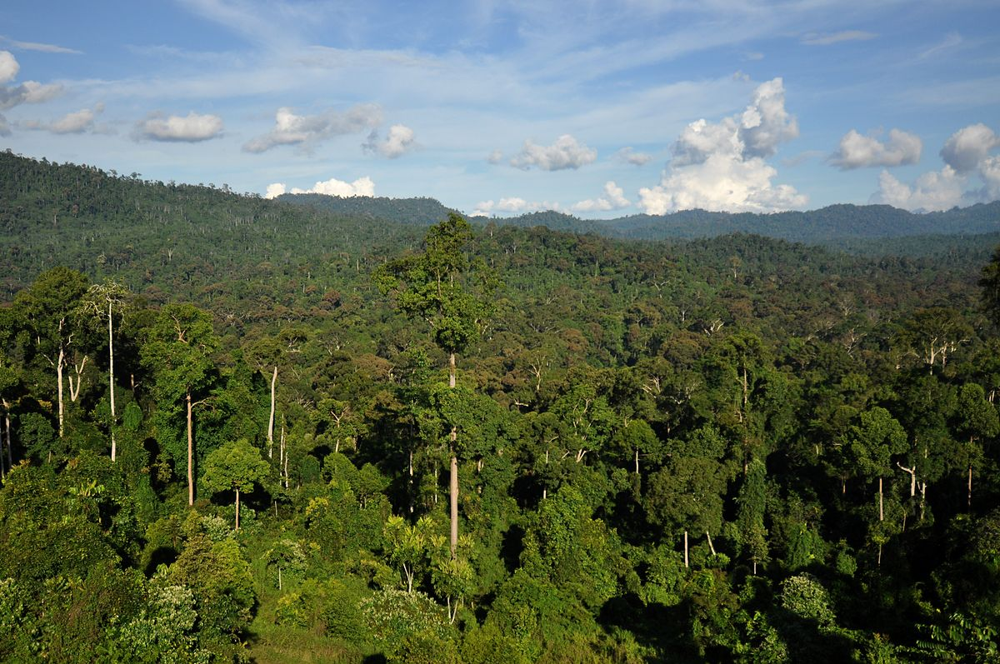
:::
:::

:::

::: notes
Directly measuring the physiological traits of every species in a forest containing hundreds of coexisting species takes substantial effort. This motivated the idea of using phylogenetic relatedness as a proxy for ecological similarity.

:::
---

## Assuming closely related species are more ecologically similar{.small}

-  Genus:species ratio: Relatedness as a substitute for ecological similarity

::: fragment
::: columns
::: {.column width="50%"}
Community with 1 genus and 3 species (1:3)

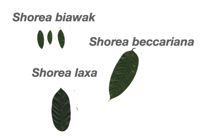
:::

::: {.column width="50%"}
Community with 3 genus and 3 species (3:3)

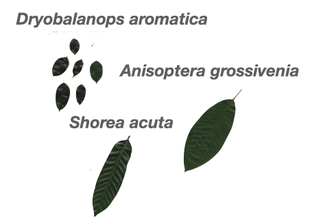
:::
:::
:::

::: incremental
- A [**low**]{.blue} genus:species ratio indicates closely related species coexist.

   - [**Environmental filtering**]{.blue}

- A [**high**]{.orange} genus:species ratio indicates distantly related species coexist.

  - [**Limiting similarity**]{.orange}

:::

::: notes
Species that I collected

This is a historical hypothesis. It requires the assumption that closely related species are more ecologically similar, meaning that the relevant traits are phylogenetically conserved. The next slide questions this assumption.

:::
---

## Assuming closely related species are more ecologically similar{.small}

-  Genus:species ratio: Relatedness as a substitute for ecological similarity

::: columns
::: {.column width="50%"}
Community with 3 genus and 3 species (3:3)

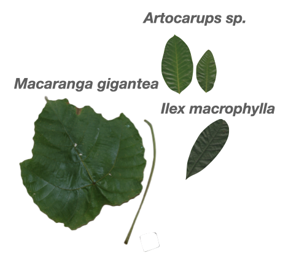
:::

::: {.column width="50%"}
Community with 3 genus and 3 species (3:3)


:::
:::

- A [**low**]{.blue} genus:species ratio indicates closely related species coexist.

   - [**Environmental filtering?**]{.blue}

- A [**high**]{.orange} genus:species ratio indicates distantly related species coexist.

  - [**Limiting similarity?**]{.orange}

::: notes
- Macaranga: Euphorbiaceae
- Artocarups: Moraceae
- Ilex: Aquifoliaceae

:::
::: notes
Genera differ in their divergence ages, so identical genus:species ratios need not represent identical evolutionary distances. Further historical background is in the supplementary slides.

:::
---

## Solution for the genus:species ratio problem = Use phylogenetic trees{.small}


::: {.cell layout-align="center"}
::: {.cell-output-display}
{fig-align='center' width=960}
:::
:::


::: notes
Use branching order and branch lengths to express relatedness, rather than taxonomic ranks such as genus and species. This tree is illustrative; its branch lengths do not represent actual evolutionary time.

:::
---

## Phylodiversity

::: footer
[1] Dimensions of Biodiversity, NSF
:::

::: columns
::: {.column width="50%"}
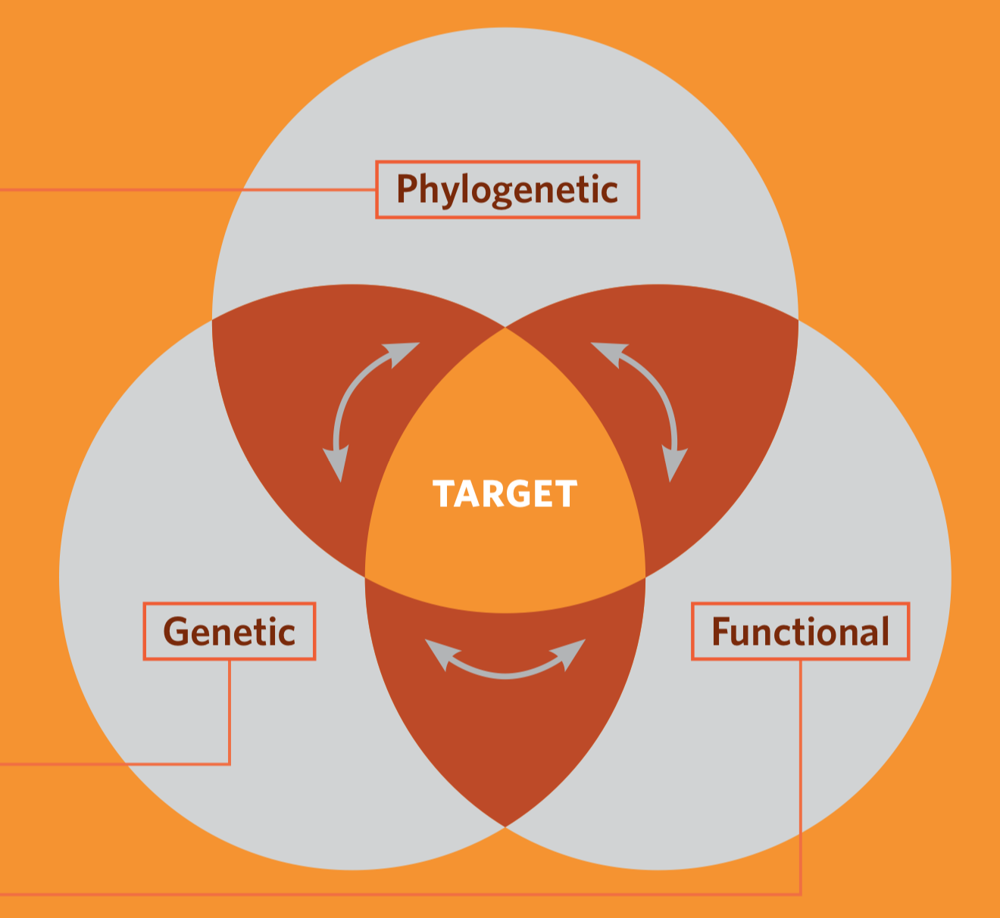
:::

::: {.column width="50%"}
- In the 1990's conservation biologists recognized the *biodiversity* is not only species diversity

    - Biodiversity has several axes or dimensions including genetic, taxonomic, phylogenetic and functional diversity
:::
:::

---

## Faith's Index (PD)

::: footer
[1] Faith 1992, Biological Conservation
:::

::: columns
::: {.column width="50%"}


::: {.cell layout-align="center"}
::: {.cell-output-display}
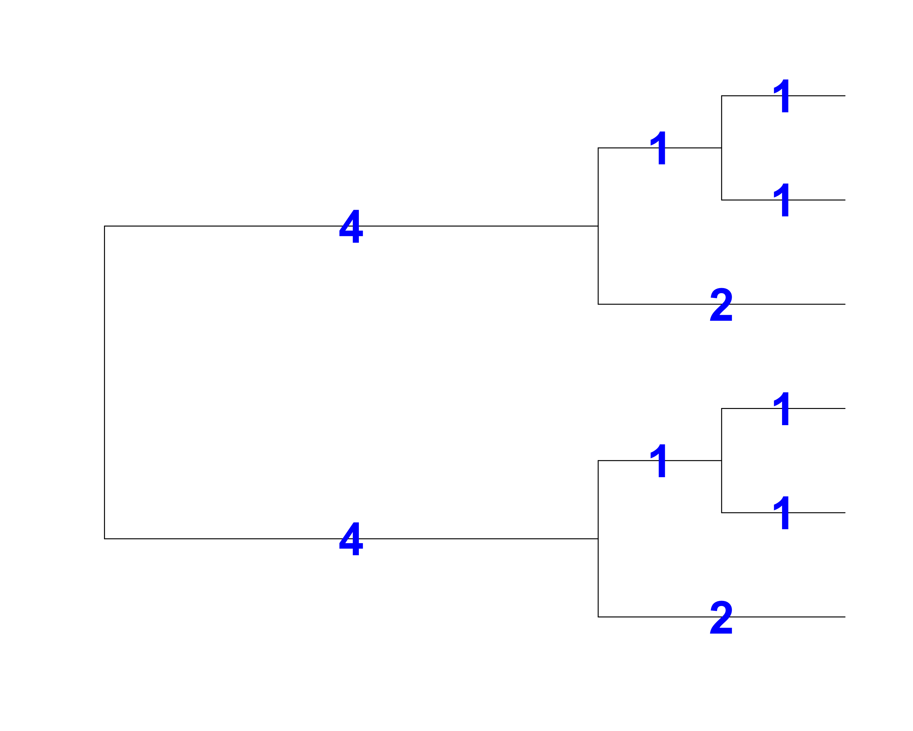{fig-align='center' width=960}
:::
:::


- Total branch length = 18

:::


::: {.column width="50%"}

::: fragment
- PD is the sum of the lengths of all those branches that are members of the corresponding minimum spanning path
:::

::: fragment
- PD is the phylogenetic analogue of taxon richness and is expressed as the number of tree units which are found in a sample
:::

::: fragment
- PD will correlate with species richness
:::

:::
:::

---

## Same species richness, different phylogenetic diversity

::: columns
::: {.column width="50%"}
Three closely related species


::: {.cell layout-align="center"}
::: {.cell-output-display}
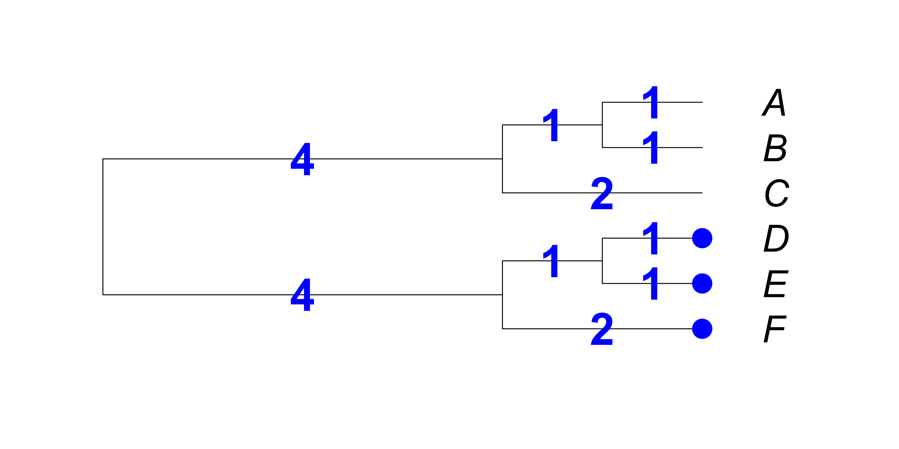{fig-align='center' width=960}
:::
:::


PD = 9
:::
::: {.column width="50%"}
Three species spread across the tree


::: {.cell layout-align="center"}
::: {.cell-output-display}
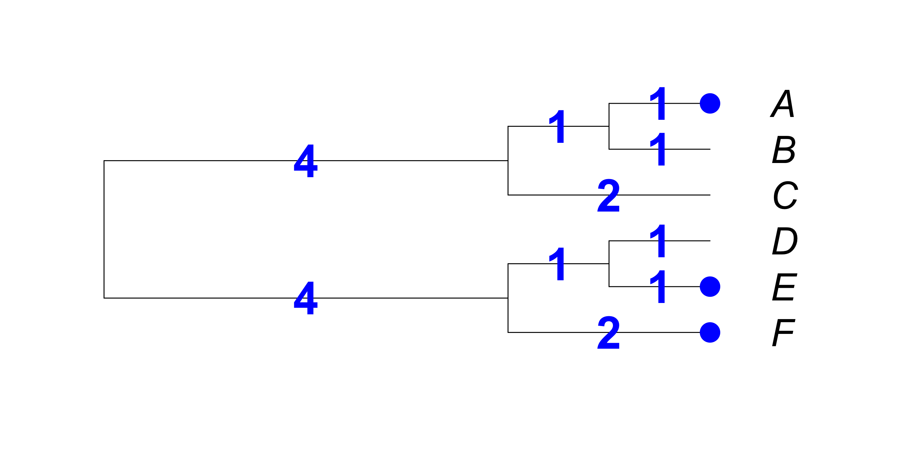{fig-align='center' width=960}
:::
:::


PD = 14
:::
:::

::: footer
Faith 1992, Biological Conservation
:::

::: notes
Species richness is identical, but the total length of the branches connecting the selected species differs. The supplementary slides retain the steps for adding individual branch lengths.
On the left (D, E, F), 1+1+2+1+4 = 9, including the branch of length 4 leading to the root, as in the default behavior of picante's pd(). Some definitions exclude the root, so use the same definition when making comparisons.

:::
---

## PD, MPD and MNTD: what do we measure?

::: columns
::: {.column width="45%"}

::: {.cell layout-align="center"}
::: {.cell-output-display}
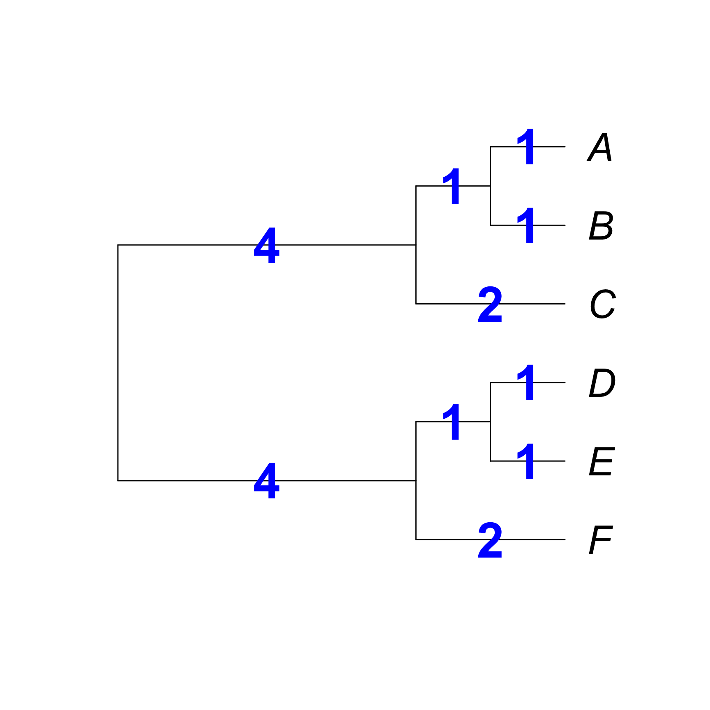{fig-align='center' width=576}
:::
:::

:::
::: {.column width="55%"}
::: small
- **PD:** sum the connecting branches, counting each branch once.
- **MPD (Mean Pairwise Distance):** average the path lengths over all species pairs.
- **MNTD (Mean Nearest Taxon Distance):** average the distance to each species' nearest neighbor.

::: fragment
**Example:** A–B = 1 + 1 = 2; A–C = 1 + 1 + 2 = 4.

MPD includes both pairs. For A's contribution to MNTD, only its nearest neighbor B counts.
:::
:::
:::
:::

::: footer
Faith 1992; Webb 2000
:::

::: notes
PD is a total that counts each shared branch only once. MPD and MNTD are averages of path lengths between species; neither is PD divided by species richness. Trace the branch lengths on the left to check A–B and A–C. The MNTD example shows only A's contribution. For the community value, find the nearest-neighbor distance for every species and then take the average.

:::
---

## Same richness, different aspects of community structure

| Community | PD | MPD | MNTD |
|:----------|---:|----:|-----:|
| A, B, C, D | 15 | 7.67 | 5.00 |
| A, B, D, E | 14 | 8.67 | 2.00 |

::: small
::: incremental
- **Higher PD in A, B, C, D:** more evolutionary history in total, including the isolated lineage D.
- **Higher MPD in A, B, D, E:** more pairs span the deep split between the A–B and D–E lineages.
- **Lower MNTD in A, B, D, E:** every species has a close relative, forming two pairs within the community.
:::

::: fragment
**A community can contain distant lineages and close relatives at the same time.**
:::
:::

::: footer
Faith 1992; Webb 2000; Tucker et al. 2017, Biological Reviews
:::

::: notes
Both communities contain four species, but species identity changes the total evolutionary history, overall separation, and arrangement of close relatives.
In ABCD, D has no close relative, so MNTD is higher. In ABDE, every species has a relative at distance 2, so MNTD is lower. Meanwhile, the number of pairs spanning the deep split increases from three to four, raising MPD. PD decreases from 15 to 14.
Ecologically, a community can span the phylogeny while every species also has a close relative within the community. Which community is "more diverse" therefore depends on whether the question emphasizes total evolutionary history for conservation, overall phylogenetic separation, or nearest-neighbor relationships.
These values describe phylogenetic structure; they do not identify environmental filtering or competition on their own. Assess clustering or overdispersion against a null model that accounts for the species pool, richness, and other relevant constraints. Interpreting phylogenetic distance as niche difference also requires correspondence with traits, leading into the Anole example.

:::
---

## Do phylogenetically related species have similar ecological niches?{.small}

::: footer
[1] Anolis ecomorphs (Wikipedia)
:::


::: columns
::: {.column width="45%"}
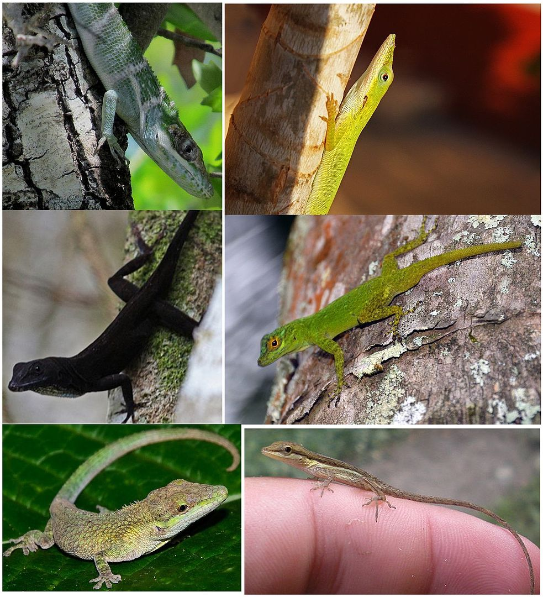
:::

::: {.column width="55%"}
::: incremental
- We are assuming that related species are ecologically similar

- Related species sometimes have very different traits and ecological niches (e.g., grass-bush, trunk, trunk-crown, trunk-ground and twig ecomorphs)
:::

:::
:::

::: notes
- the study was done in 1998, but people usually ignore something inconvenient

:::
---

## Functional dendrogram vs. phylogeny (Anole example){.small}

::: footer
[1] Losos et al. 1998, Science
:::

::: columns
::: {.column width="50%"}
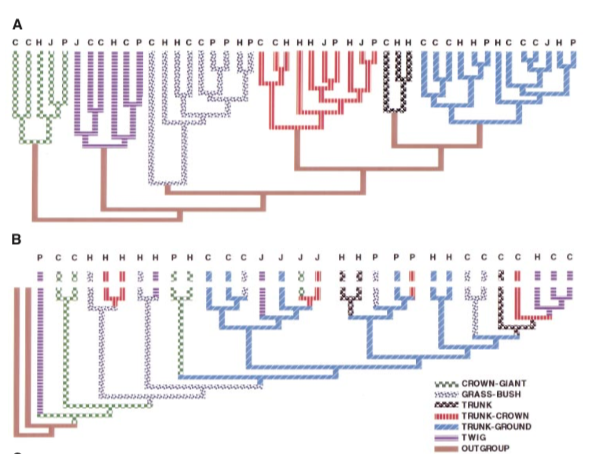
:::

::: {.column width="50%"}
::: incremental

- A: Functional dendrogram based on ecomorph

- B: Phylogeny indicates frequent evolution of traits

- They do not match: the same ecomorphs evolved independently on different islands

- Phylogenetically similar = Functional (ecologically) similar??

:::

:::
:::

::: notes
Colors indicate ecomorphs; letters above the tips indicate islands (C: Cuba, H: Hispaniola, J: Jamaica, P: Puerto Rico). In A, tips of the same color cluster together. In phylogeny B, the same colors appear repeatedly within different island lineages. Related species within islands diversified into different ecomorphs, while similar ecomorphs evolved independently on different islands (convergent evolution).

:::
---

## Do phylogenetically related species have similar ecological niches? {#anole-combined .small}

::: columns
::: {.column width="35%"}


<p style="font-size:0.7em; line-height:1.2; margin-top:0.3em;">Different ecomorphs occupy different microhabitats.</p>
:::

::: {.column width="65%"}


::: {.cell layout-align="center"}
::: {.cell-output-display}
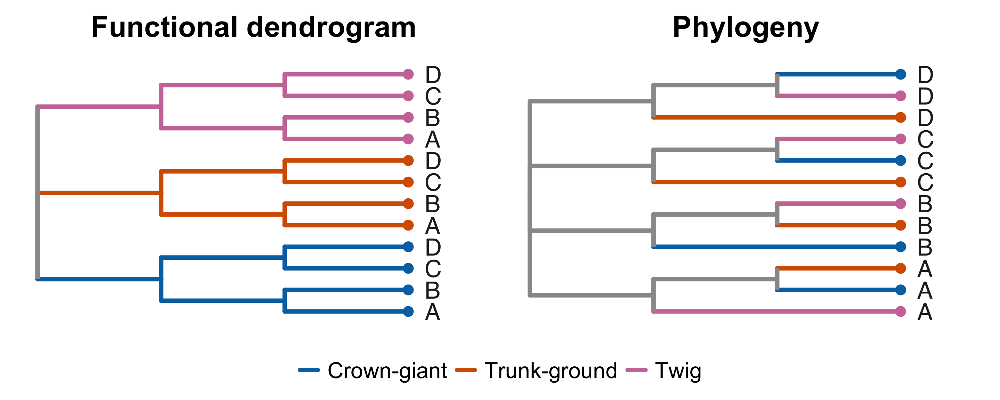{fig-align='center' width=100%}
:::
:::


<p style="font-size:0.7em; line-height:1.2; margin:0;">A–D: hypothetical islands. Same color + letter = same species.
<br>Schematic illustration based on Losos et al. (1998).</p>

:::
:::

::: {.small}
- Similar ecomorphs evolved independently on different islands.
- Closely related species do not always have similar traits.
:::

::: footer
Anolis ecomorphs (Wikipedia); Losos et al. 1998, Science
:::

::: notes
The photographs on the left show ecomorph diversity. The schematic uses 12 fictional species (3 ecomorphs × 4 islands). Each combination of color and island letter identifies one species. A–D represent fictional Islands A–D and do not correspond to real islands. The functional dendrogram groups the four species of each ecomorph together; the phylogeny places different ecomorphs close together. The same 12 species therefore form different functional and phylogenetic groups. Branch lengths, branching order, and relationships among islands are illustrative; they do not reproduce the estimates or migration routes in Losos et al. (1998). The biological conclusion is based on that paper.

:::
---

## Phylogenetic signal: does relatedness predict trait similarity?{.small}

::: columns
::: {.column width="30%"}
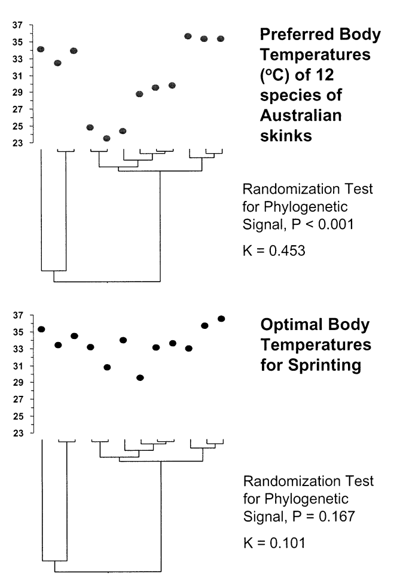
:::
::: {.column width="70%"}
::: incremental
- Phylogenetic signal describes how trait similarity is associated with relatedness.
- Check the traits relevant to the ecological question before using phylogeny as their proxy.
- Signal can differ among traits; relatedness alone does not establish ecological similarity.
:::
:::
:::

::: footer
Blomberg et al. 2003, Evolution
:::

::: notes
Quantitative explanations of K and Pagel's lambda are in the supplementary slides. Here, emphasize checking the relationship between traits and phylogeny before using relatedness as a proxy for traits.

:::
---

## The phylogenetic middleman problem

::: footer
[1] Swenson 2013, Ecography
:::


::: columns
::: {.column width=35%}
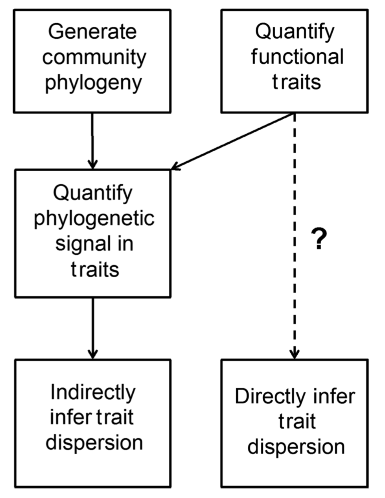
:::

::: {.column width=65%}
::: incremental
- Phylogeny as a proxy for the functional or ecological similarity of species.

- Measure traits → show phylogenetic signal → use phylogeny to infer trait-based processes.

- Compared to simply measuring the trait dispersion, this approach is very indirect.

- **If the traits are measured, quantify trait dispersion directly.**
:::
:::

:::

::: notes
This does not reject phylogenetic diversity itself. PD describes the amount of evolutionary history, whereas trait distances describe differences in the measured traits. If trait dispersion is the question and the relevant traits can be measured, quantify it directly rather than using phylogeny as an intermediary.

:::
---

## Plant functional traits

Measurable properties of plants that are indicative of ecological strategies

::: columns
::: {.column width=50%}
"Hard" traits: e.g., Photosynthetic rates


:::

::: {.column width=50%}
"Soft" traits: e.g., LMA (leaf mass per area)


:::
:::

---

## Leaf Economic Spectrum (LES)

::: footer
[1] Reich et al. 1997, PNAS

[2] Wright et al. 2004, Nature
:::

::: columns
::: {.column width=20%}
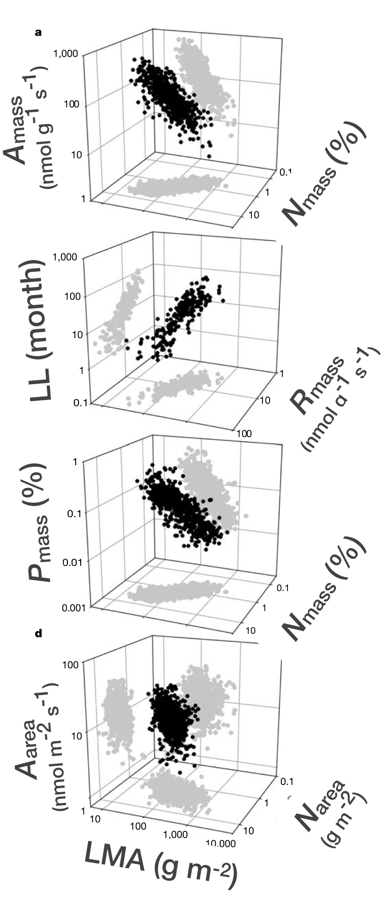
:::

::: {.column width=80%}
::: incremental
::: small
- Pairwise correlations among leaf traits in a global database (GLOPNET)
- Six leaf traits covary along a single main axis (75 % of their variation)
- Multidimensional leaf traits can be summarized by a one-dimensional index
- Controversial because global among‑species patterns don’t always match within‑species or local patterns
:::
:::
:::
:::

::: notes
Quick return (low LMA, short leaf lifespan, high photosynthesis and nitrogen per unit mass): recover resources rapidly using inexpensive leaves. Slow return: retain expensive, durable leaves for longer. This is an axis of covariation among leaf traits, not a direct measure of whole-plant strategy or community diversity. The 75% value comes from the analysis in Wright et al. (2004).
The next slide examines how some of these correlations depend on normalization per unit mass or per unit area.

:::
---

## Leaf trait correlations depend on normalization

$$
A_{\mathrm{mass}} = \frac{A_{\mathrm{area}}}{\mathrm{LMA}},
\qquad
N_{\mathrm{mass}} = \frac{N_{\mathrm{area}}}{\mathrm{LMA}}
$$

::: incremental
- Expressing traits per unit mass or per unit area can change their correlations.
- **Example:** if photosynthesis per unit area stays constant while LMA doubles, photosynthesis per unit mass halves.
- A shared denominator, LMA, can strengthen correlations between mass-based traits, even when their area-based values vary independently.
:::

::: fragment
**Ask what generates the correlation before interpreting it as a physiological trade-off.**
:::

::: footer
Osnas et al. 2013, Science · doi:10.1126/science.1231574
:::

::: notes
Source: https://doi.org/10.1126/science.1231574
A denotes photosynthetic rate and N denotes nitrogen content. The subscripts mass and area mean per unit dry mass and per unit leaf area, respectively. The equations follow from unit conversion.
The example of doubling LMA is hypothetical and isolates the effect of normalization; it is not an observed treatment effect. Even if area-based photosynthesis and nitrogen are uncorrelated, dividing both by the same LMA can generate a correlation between their mass-based values.
This does not mean that the LES is meaningless. Consider how biological variation and normalization each contribute to correlations, including the relationship between LMA and leaf lifespan. Nor does it imply that area-based normalization is always correct.

:::
---

## Rebuilding community ecology from functional traits

::: footer
[1] McGill et al. 2006, Trends in Ecology and Evolution
:::

::: incremental
- Non-trait based statement

   - *Campanula aparinoides* is found only in infertile habitats.

- Trait-based statement

   - Compact plants with canopy area < 30 cm <sup>2</sup>  and small or absent leaves are restricted to marshes with < 18 $\mu$ g g <sup>-1</sup> soil P.
:::

---

## Community traits: mean vs. diversity

::: columns
::: {.column width="55%"}

::: {.cell layout-align="center"}
::: {.cell-output-display}
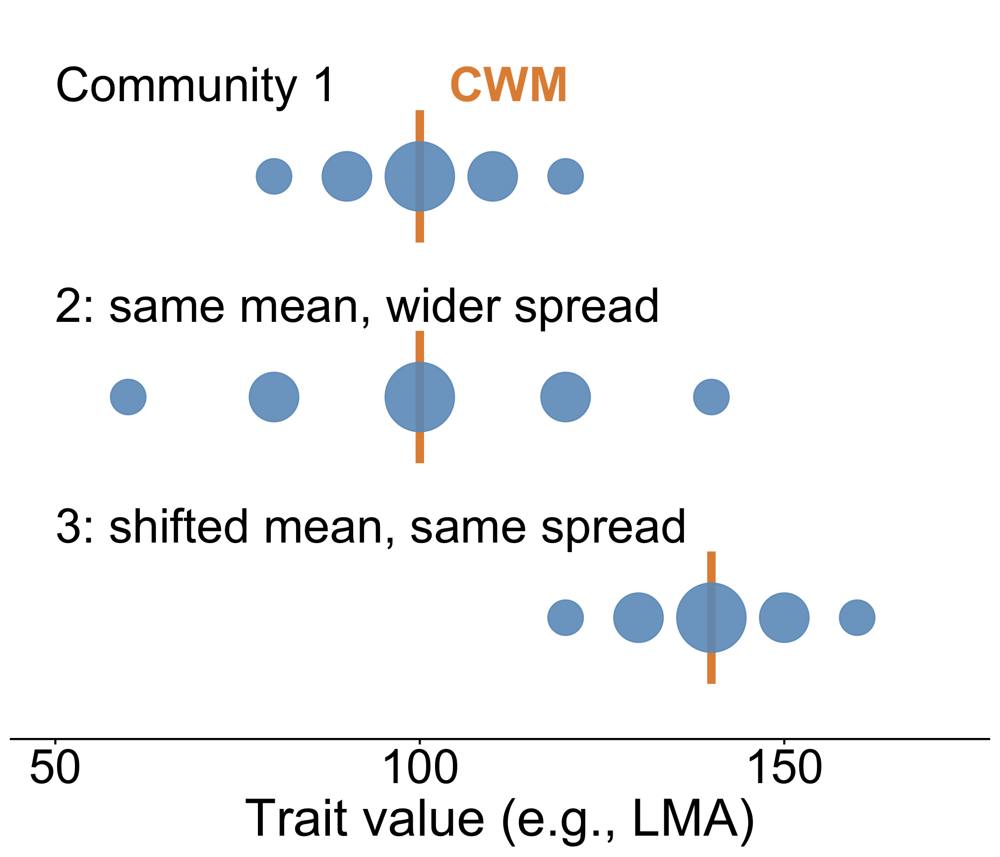{fig-align='center' width=672}
:::
:::

:::
::: {.column width="45%"}
- **Community-weighted mean (CWM)**

  $\mathrm{CWM} = \Sigma p_i t_i$

  Which strategy dominates?

::: fragment
- **Functional diversity**

  How different are the coexisting strategies?
:::

::: fragment
**The mean and the spread can change independently.**
:::
:::
:::

::: footer
*p*<sub>*i*</sub>: relative abundance of species *i* · *t*<sub>*i*</sub>: trait value of species *i*
:::

::: notes
The weights p_i may represent relative abundance, biomass, or cover. CWM asks where the community's "center" lies; functional diversity asks how different the species are from one another. Community 2 has the same mean but greater spread, whereas community 3 has the same spread but a shifted mean.
The following FD and convex hull examples address spread; the later BCI example addresses CWM, or the center. Distances and volumes also depend on trait selection, units, and standardization.

:::
---

## Petchey & Gaston's functional diversity (FD)

::: columns
::: {.column width="50%"}
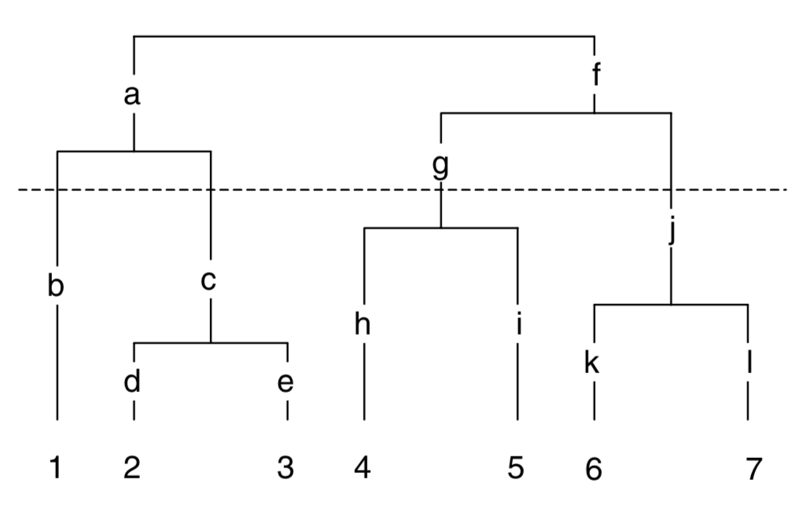
:::
::: {.column width="50%"}
::: incremental
- Functional diversity: differences in species' functional traits.
- **Functional dendrogram:** built from measured trait differences (a phylogeny represents shared ancestry).
- **Petchey & Gaston's FD:** total branch length connecting the community's species.
- Parallels Faith's PD, but uses trait differences instead of evolutionary history.
:::
:::
:::

::: footer
Petchey & Gaston 2002, Ecology Letters
:::

::: notes
Functional diversity is an umbrella concept; FD, introduced here, is one particular metric. Calculate distances between species from trait data, then cluster them to produce a dendrogram. Branch lengths do not represent evolutionary time. The following convex hull example measures functional richness using the extent of occupied trait space rather than a dendrogram.

:::
---

## Convex hull volume (functional richness)


::: footer
[1] Cornwell et al. 2006, Ecology
:::

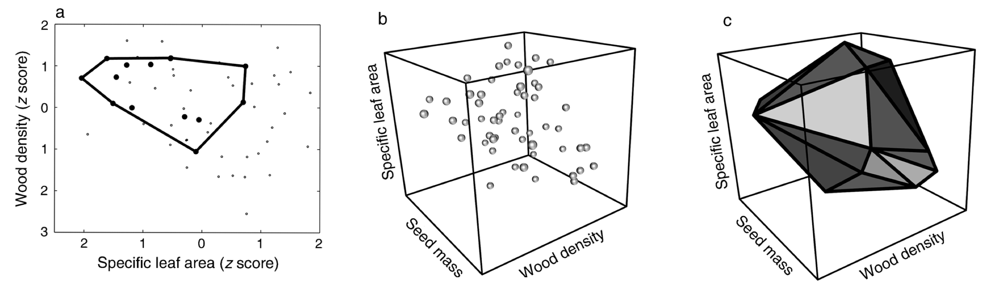

::: incremental

- California woody-plant communities (43 plots, 54 species, 3 traits)

- Is the trait volume of each community smaller than expected by chance?
    - Null model: same number of species, drawn at random from the pool

:::

::: notes
Panel a: points represent species, and axes represent traits standardized as z-scores. Large black points are species in one community; small points are the remaining species. The enclosing polygon represents the trait space occupied by that community. Panels b and c extend the same idea to the volume of a convex hull in three-trait space.
Volume depends on trait selection, units, and standardization.

:::
---

## Convex hull volume (functional richness)

::: footer
[1] Cornwell et al. 2006, Ecology
:::

::: columns
::: {.column width=58%}
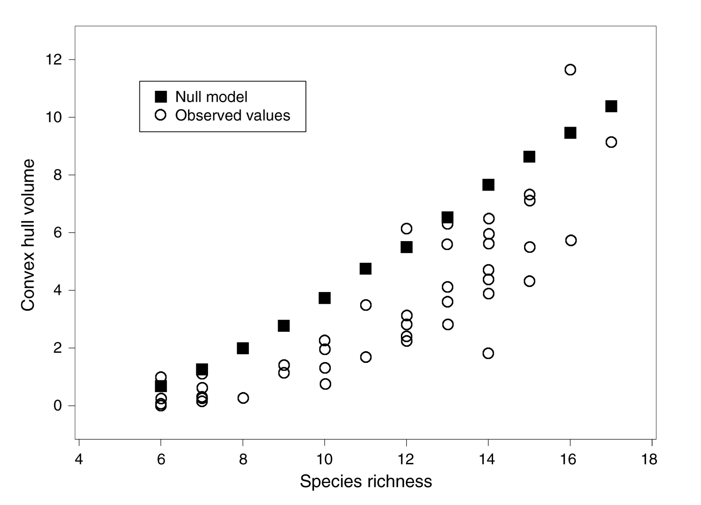
:::

::: {.column width=42%}
::: incremental

- Species in 40 out of 43 plots occupied less trait space than would be expected by chance

- Consistent with environmental filtering

:::
:::
:::

::: notes
The horizontal axis is species richness. Volume increases with richness, so compare communities with the null expectation for the same richness (black squares). White circles below the black squares indicate narrower occupied trait space than expected (observation). This is consistent with environmental filtering (interpretation), but does not directly demonstrate the process.

:::
---

## Community assembly and trait distribution


::: footer
[1] Cornwell & Ackerly 2009, Ecological Monographs
:::

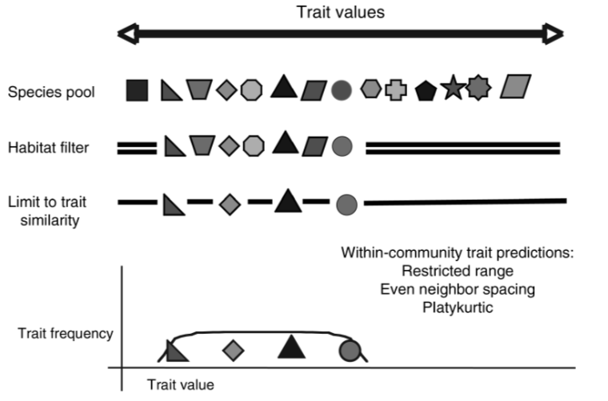

::: notes
A narrower range of trait values and more even spacing of species within that range are different properties. The former is a prediction of environmental filtering, whereas the latter is a prediction of limiting similarity. The next empirical example examines both.

:::
---

## Environmental filtering and limiting similarity can co-occur{.small}


::: footer
[1] Kraft et al. 2008, Science
:::

::: columns
::: {.column width=52%}
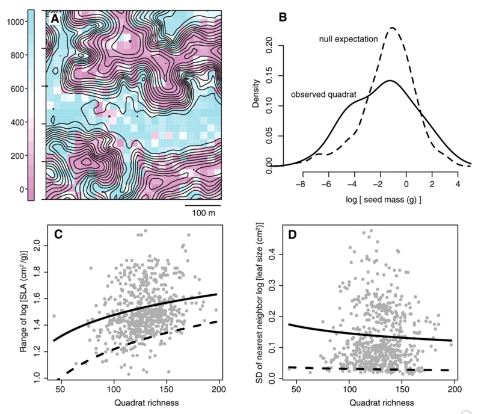
:::

::: {.column width=48%}
::: incremental

- Yasuni tropical tree communities, 25ha, 625 20m x 20m quadrats, 1089 species!

- A: Ridgetops have lower than expected SLA and valleys have higher
    - Traits match environmental conditions → consistent with environmental filtering

- B: Seed mass shows broader distribution than expected → consistent with limiting similarity

- C: Range of SLA is smaller than expected → consistent with environmental filtering

:::
:::
:::

::: notes
SLA (specific leaf area) = leaf area / dry mass = 1/LMA.
Panel B: the solid line shows observations and the dashed line shows the null expectation. The observed distribution is flatter and broader. Panel C: each point is a quadrat, and the horizontal axis is species richness. Most points lie below the solid line, indicating narrower ranges than expected. Panel D is not covered here; it uses variation in nearest-neighbor distances to assess the regularity of spacing among trait values.
As the title's wording "can co-occur" suggests, these patterns are consistent with the proposed processes; they do not directly demonstrate those processes.

:::
---

## How ecological processes might influence community assembly{.small}


::: {.cell layout-align="center"}
::: {.cell-output-display}
`````{=html}
<table class=" lightable-material lightable-striped lightable-hover" style='font-size: 30px; font-family: "Source Sans Pro", helvetica, sans-serif; margin-left: auto; margin-right: auto;'>
 <thead>
  <tr>
   <th style="text-align:left;"> Process / Factor </th>
   <th style="text-align:left;"> Possible pattern </th>
  </tr>
 </thead>
<tbody>
  <tr grouplength="1"><td colspan="2" style="border-bottom: 1px solid;"><strong>Abiotic environment</strong></td></tr>
<tr>
   <td style="text-align:left;padding-left: 2em;" indentlevel="1"> Environmental filtering </td>
   <td style="text-align:left;"> Clustering </td>
  </tr>
  <tr grouplength="4"><td colspan="2" style="border-bottom: 1px solid;"><strong>Biotic interactions: competition and natural enemies</strong></td></tr>
<tr>
   <td style="text-align:left;padding-left: 2em;" indentlevel="1"> Limiting similarity / Competitive exclusion </td>
   <td style="text-align:left;"> Overdispersion </td>
  </tr>
  <tr>
   <td style="text-align:left;padding-left: 2em;" indentlevel="1"> Competitive hierarchy / directional competition </td>
   <td style="text-align:left;"> Clustering </td>
  </tr>
  <tr>
   <td style="text-align:left;padding-left: 2em;" indentlevel="1"> Herbivores / Parasites / Pathogens </td>
   <td style="text-align:left;"> Overdispersion </td>
  </tr>
  <tr>
   <td style="text-align:left;padding-left: 2em;" indentlevel="1"> Pollinator-mediated competition </td>
   <td style="text-align:left;"> Overdispersion </td>
  </tr>
  <tr grouplength="2"><td colspan="2" style="border-bottom: 1px solid;"><strong>Biotic interactions: facilitation</strong></td></tr>
<tr>
   <td style="text-align:left;padding-left: 2em;" indentlevel="1"> Nurse plants </td>
   <td style="text-align:left;"> Overdispersion </td>
  </tr>
  <tr>
   <td style="text-align:left;padding-left: 2em;" indentlevel="1"> Pollinator facilitation </td>
   <td style="text-align:left;"> Clustering </td>
  </tr>
  <tr grouplength="1"><td colspan="2" style="border-bottom: 1px solid;"><strong>Stochastic process</strong></td></tr>
<tr>
   <td style="text-align:left;padding-left: 2em;" indentlevel="1"> Neutral theory </td>
   <td style="text-align:left;"> Random </td>
  </tr>
</tbody>
</table>

`````
:::
:::


::: notes
Different processes can produce the same pattern. For example, clustering can arise from environmental filtering or from competitive hierarchy, where only species with competitively advantageous traits remain. Patterns do not uniquely identify processes. In addition to null-model comparisons, we need hypotheses that connect traits to processes.

:::
---

##  Competitive hierarchy


::: footer
[1] $t_A$ and $t_B$ are the functional trait values of species A and B

[2] Kunstler et al. 2012, Ecology Letters
:::

::: columns
::: {.column width=50%}
{width="200px"}

### Limiting similarity

Competitive interaction strengths between species will increase with decreasing niche distance, measured as their absolute traits distance $|t_A - t_B|$
:::

::: {.column width=50%}
{width="200px"}

### Competitive hierarchy

Competitive effects of species A on species B will increase with increasing $t_A - t_B$.
:::

:::

::: notes
Tree height illustrates a trait for which a larger value can confer a competitive advantage. On the left, greater similarity means stronger competition, so the absolute difference matters. On the right, which species has the larger value matters, so the signed difference matters. This is not a general rule that larger values are advantageous for every trait.

:::
---

## Plant–herbivore interactions


::: footer
[1] Endara et al. 2022, Journal of Ecology
:::

::: columns
::: {.column width=40%}
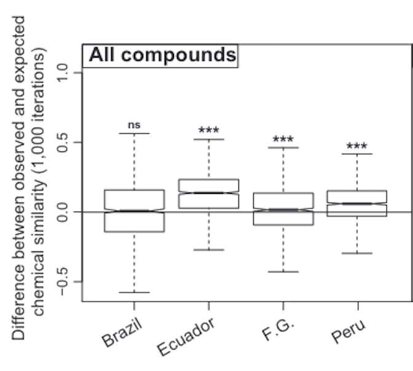
:::

::: {.column width=60%}
::: incremental

- 6000+ secondary metabolites from nearly 100 *Inga* species at four sites across Amazonia

- Coexisting species differ more in defensive chemistry than expected by chance

- Authors suggest that plant–herbivore interactions help maintain local tree diversity
:::
:::
:::

::: notes
The zero line represents the null expectation. The paper concludes that species in local communities are more chemically different than expected by chance, indicating differentiation in defense chemistry. Check the original figure caption before explaining whether the vertical-axis difference is observed minus expected or the reverse. The Brazil result is not significant.
This is a study of local communities of one genus, Inga, across four regions, not an experiment directly manipulating herbivore effects.

:::
---

## Trait-based ecology: where are we now?


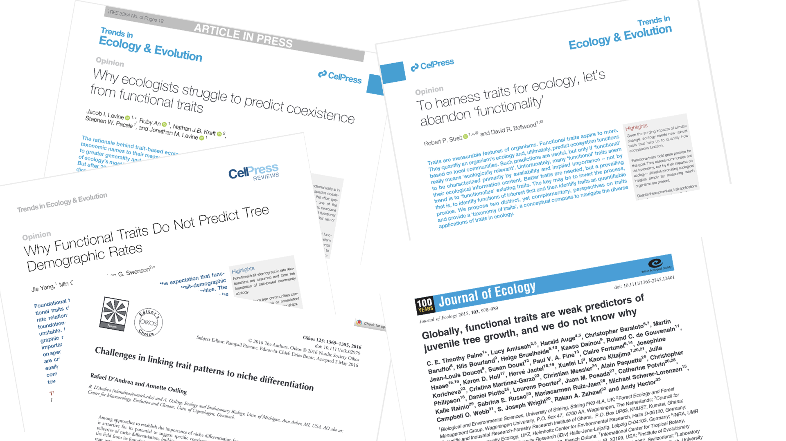

::: notes
Roadmap for the next three examples: (1) from community means to individual species (CWM at BCI); (2) from species means to differences within and among species (the components of LMA); and (3) from measured traits to predictions of physiology and coexistence.

:::
---

## Community averages can mislead without species‑level context{.small}

::: footer
[1] Katabuchi et al. 2017, Ecology

[2] Swenson et al. 2020, Ecological Monographs
:::

::: columns
::: {.column width="55%"}
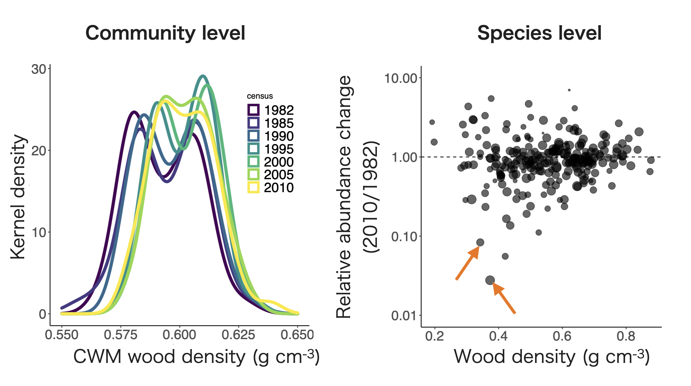

:::
::: {.column width="45%"}
::: {.small}
- **Study site:** 50-ha forest dynamics plot, Barro Colorado Island, Panama.
- **Community-level pattern:** Increasing CWM wood density appears consistent with a response to drier conditions.
- **Species-level explanation:** Just two species account for ~60% of the temporal CWM shift, suggesting that species-specific processes may drive the apparent community trend.
:::
:::
:::

::: notes
Two of approximately 300 species (~0.7%) account for ~60% of the temporal CWM shift. Species-specific pathogens were suggested as a possible explanation, rather than a community-wide climate response.

:::
---

## Why leaf trait relationships differ within and among species

::: columns
::: {.column width="58%"}
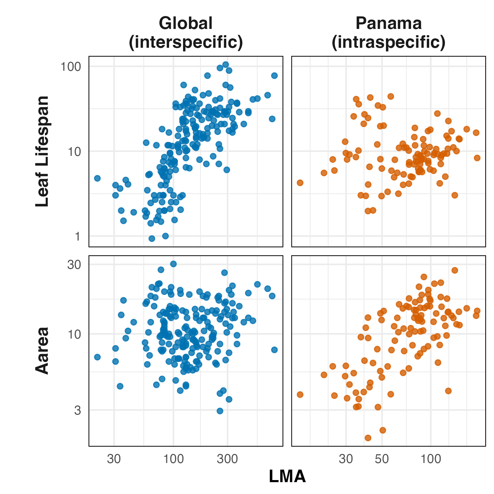

:::
::: {.column width="42%"}
::: {.small}
- **Across species:** Leaf lifespan increases strongly with LMA, whereas area-based photosynthesis shows a weak relationship.
- **Within species:** Area-based photosynthesis increases with LMA in the studied Panama assemblages.
- **Proposed mechanism:** LMA variation reflects different contributions of photosynthetic and structural tissues.
:::
:::
:::

::: footer
Osnas, Katabuchi et al. 2018, PNAS · doi:10.1073/pnas.1803989115
:::

::: notes
Source: https://doi.org/10.1073/pnas.1803989115
The global and Panama datasets also differ in geographical scale, so do not attribute every contrast solely to within-species versus among-species variation.
Return to the 2013 normalization example: the same change in LMA can have different physiological meanings depending on its components.
The proposed hypothesis is that variation in photosynthetically active mass contributes strongly to LMA variation between sun and shade leaves within species, whereas variation in structural mass contributes strongly across species. The data are consistent with these predictions; the claim is not that identical relationships hold in every within-species and among-species comparison.
Structural mass relates to strength and leaf lifespan. Rather than applying correlations among species means directly to responses within species, consider the components that generate LMA. The next example extends this reasoning to physiological prediction.

:::
---

## Separating LMA components improves physiological prediction

::: columns
::: {.column width="60%"}
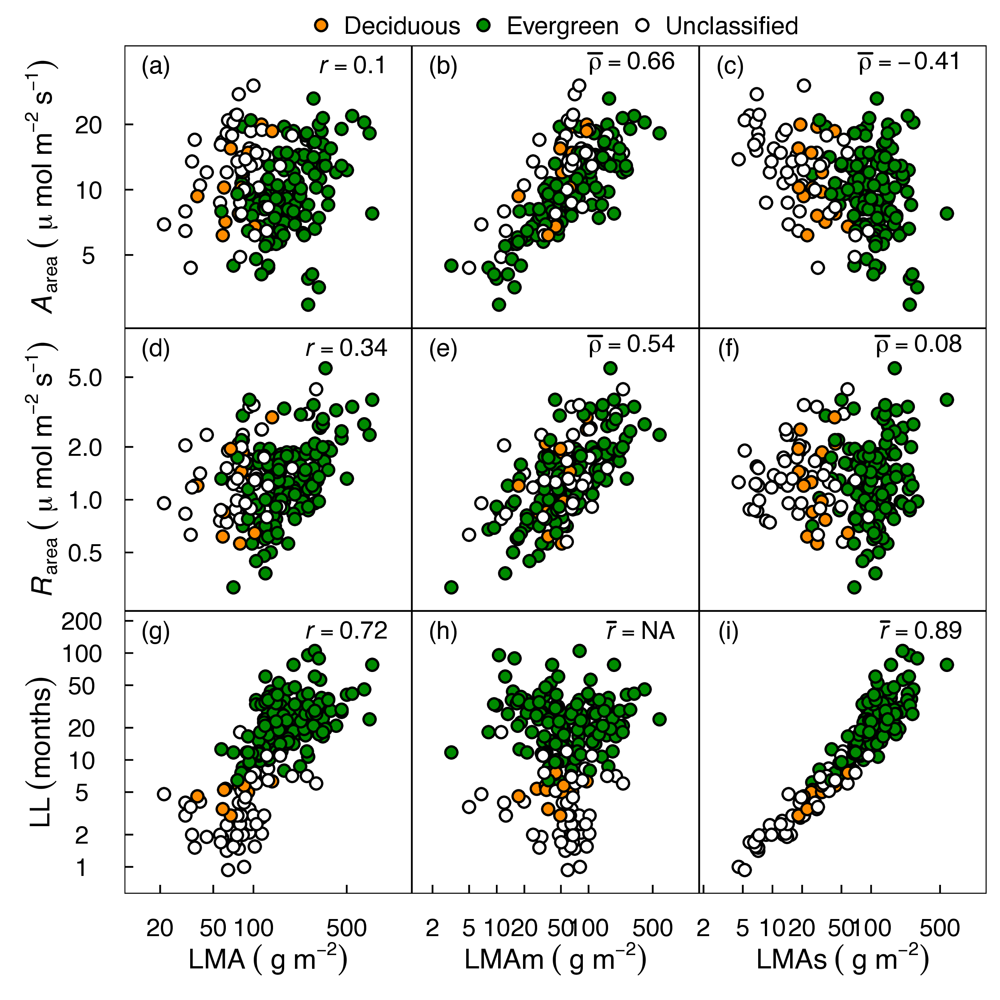
:::
::: {.column width="40%"}
::: {.small}
- Bulk LMA combines metabolic and structural components.
- Metabolic mass (LMAₘ) is more strongly associated with photosynthesis and respiration per leaf area.
- Structural mass (LMAₛ) is strongly associated with leaf lifespan.

Separating metabolic and structural components reveals distinct functional relationships obscured by bulk LMA.
:::
:::
:::

::: footer
Katabuchi et al. 2025, Oecologia
:::

::: notes
Reading order: for photosynthesis, compare (a) LMA with (b) LMAm; for leaf lifespan, compare (g) LMA with (i) LMAs. LMAm is photosynthetically active (metabolic) mass; LMAs is structural mass.
Move from total LMA to its component parts. Present this as an example of improved physiological prediction.
The prediction target here is physiology; the study does not demonstrate prediction of coexistence or invasion growth rates. Do not equate this result with the process-informed metrics for coexistence prediction discussed by Levine et al. The next slide presents the connection from physiology to population dynamics and coexistence as a separate challenge.

:::
---

## From physiological prediction to species coexistence

::: columns
::: {.column width="63%"}
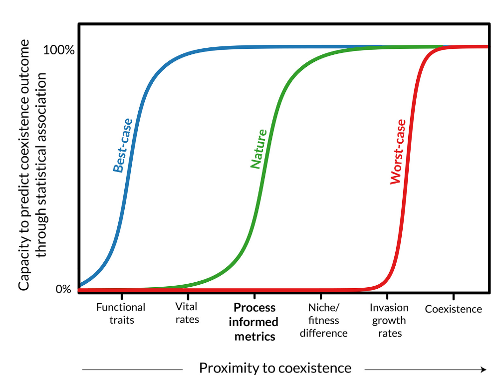

<span style="font-size:0.55em;">Conceptual illustration</span>

:::
::: {.column width="37%"}
::: {.small}
- **Traits alone are insufficient** to predict species coexistence.
- Predictive models must link traits and physiology to **demographic rates** and **species interactions**.
- **Invasion growth rates** (growth when rare) provide a direct link to coexistence theory.
:::
:::
:::

::: footer
Levine et al. 2024, Trends in Ecology & Evolution
:::

::: notes
Invasion growth rate is the population growth rate of a species introduced at low abundance into an established community. A positive value means it can increase when rare, a condition relevant to coexistence.
This is a conceptual illustration; it does not imply that predictive performance actually reaches 100%.
Improving physiological prediction by separating LMA into components does not by itself predict species coexistence. Consider the connections to individual growth, survival, reproduction, and population growth under competition.
When choosing metrics that reflect mechanisms, specify the prediction target. Physiology, population dynamics, and coexistence are different prediction targets.

:::
---

## Summary 🍺

::: incremental
- Why do we use trait and phylogenetic diversity?

  - To quantify ecological similarities and biodiversity dimensions.

  - Be careful when mapping many dimensions of biodiversity to a few indices.

  - Patterns alone do not identify processes; compare them with null models.

- Trait-based approaches

  - Moving ecology towards more quantitative and predictive methods.

  - Describing diversity is not the same as predicting dynamics or coexistence.

  - Better metrics may be needed, beyond simply measuring traits.

- How to calculate them? **R practice:** `diversity_example.qmd`
:::

---

## About the slides

-  The slides are made using [Quarto](https://quarto.org/) with [Emi Tanaka's](https://github.com/emitanaka/talks) CSS design and [Danyang Dai's](https://github.com/DanyangDai/brownbag_2022_10_11) template.

-  Source code for the slides can be found at [mattocci27/phy-fun-div](https://github.com/mattocci27/phy-fun-div)

---

## Supplementary slides {#supplementary-slides}

::: large
- Historical background and additional examples
- Step-by-step PD, MPD and MNTD calculations
- Phylogenetic signal and additional trait-based questions
:::

::: notes
The remaining slides are supplementary material and are not normally presented during class. Use them to answer questions or as references during practical exercises. The Simpson and Shannon derivations remain in the main presentation.

:::
---

## 2a) Second-Order properties with site characteristics (1950s ~){.small}

::: footer
[1] Vellend, M. (2016). The Theory of Ecological Communities. Princeton University Press
:::

::: columns
::: {.column width="50%"}


::: {.cell layout-align="center"}
::: {.cell-output-display}
`````{=html}
<table class=" lightable-material lightable-striped lightable-hover" style='font-size: 32px; font-family: "Source Sans Pro", helvetica, sans-serif; margin-left: auto; margin-right: auto;'>
 <thead>
  <tr>
   <th style="text-align:left;">   </th>
   <th style="text-align:right;"> Site 1 </th>
   <th style="text-align:right;"> Site 2 </th>
   <th style="text-align:right;"> Site 3 </th>
   <th style="text-align:right;"> Site 4 </th>
  </tr>
 </thead>
<tbody>
  <tr grouplength="4"><td colspan="5" style="border-bottom: 1px solid;"><strong>Abundance</strong></td></tr>
<tr>
   <td style="text-align:left;padding-left: 2em;" indentlevel="1"> Sp. 1 </td>
   <td style="text-align:right;"> 4 </td>
   <td style="text-align:right;"> 0 </td>
   <td style="text-align:right;"> 315 </td>
   <td style="text-align:right;"> 23 </td>
  </tr>
  <tr>
   <td style="text-align:left;padding-left: 2em;" indentlevel="1"> Sp. 2 </td>
   <td style="text-align:right;"> 300 </td>
   <td style="text-align:right;"> 250 </td>
   <td style="text-align:right;"> 0 </td>
   <td style="text-align:right;"> 18 </td>
  </tr>
  <tr>
   <td style="text-align:left;padding-left: 2em;" indentlevel="1"> Sp. 3 </td>
   <td style="text-align:right;"> 56 </td>
   <td style="text-align:right;"> 120 </td>
   <td style="text-align:right;"> 74 </td>
   <td style="text-align:right;"> 0 </td>
  </tr>
  <tr>
   <td style="text-align:left;padding-left: 2em;" indentlevel="1"> Sp. 4 </td>
   <td style="text-align:right;"> 23 </td>
   <td style="text-align:right;"> 18 </td>
   <td style="text-align:right;"> 101 </td>
   <td style="text-align:right;"> 0 </td>
  </tr>
  <tr grouplength="3"><td colspan="5" style="border-bottom: 1px solid;"><strong>Env</strong></td></tr>
<tr>
   <td style="text-align:left;padding-left: 2em;" indentlevel="1"> Env. 1 </td>
   <td style="text-align:right;"> 780 </td>
   <td style="text-align:right;"> 2500 </td>
   <td style="text-align:right;"> 480 </td>
   <td style="text-align:right;"> 1200 </td>
  </tr>
  <tr>
   <td style="text-align:left;padding-left: 2em;" indentlevel="1"> Env. 2 </td>
   <td style="text-align:right;"> 21 </td>
   <td style="text-align:right;"> 11 </td>
   <td style="text-align:right;"> 24 </td>
   <td style="text-align:right;"> 19 </td>
  </tr>
  <tr>
   <td style="text-align:left;padding-left: 2em;" indentlevel="1"> Env. 3 </td>
   <td style="text-align:right;"> 1500 </td>
   <td style="text-align:right;"> 1900 </td>
   <td style="text-align:right;"> 700 </td>
   <td style="text-align:right;"> 4500 </td>
  </tr>
</tbody>
</table>

`````
:::
:::


:::
::: {.column width="50%"}
- "Species $\times$ site" and "environment $\times$ site"
:::
:::

---

## 2b) Second-Order properties with species characteristics (2000s ~){.small}

::: footer
[1] Vellend, M. (2016). The Theory of Ecological Communities. Princeton University Press
:::

::: columns
::: {.column width="50%"}


::: {.cell layout-align="center"}
::: {.cell-output-display}
`````{=html}
<table class=" lightable-material lightable-striped lightable-hover" style='font-size: 32px; font-family: "Source Sans Pro", helvetica, sans-serif; margin-left: auto; margin-right: auto;'>
 <thead>
  <tr>
   <th style="text-align:left;">   </th>
   <th style="text-align:right;"> Site 1 </th>
   <th style="text-align:right;"> Site 2 </th>
   <th style="text-align:right;"> Site 3 </th>
   <th style="text-align:right;"> Site 4 </th>
  </tr>
 </thead>
<tbody>
  <tr grouplength="4"><td colspan="5" style="border-bottom: 1px solid;"><strong>Abundance</strong></td></tr>
<tr>
   <td style="text-align:left;padding-left: 2em;" indentlevel="1"> Sp. 1 </td>
   <td style="text-align:right;"> 4 </td>
   <td style="text-align:right;"> 0 </td>
   <td style="text-align:right;"> 315 </td>
   <td style="text-align:right;"> 23 </td>
  </tr>
  <tr>
   <td style="text-align:left;padding-left: 2em;" indentlevel="1"> Sp. 2 </td>
   <td style="text-align:right;"> 300 </td>
   <td style="text-align:right;"> 250 </td>
   <td style="text-align:right;"> 0 </td>
   <td style="text-align:right;"> 18 </td>
  </tr>
  <tr>
   <td style="text-align:left;padding-left: 2em;" indentlevel="1"> Sp. 3 </td>
   <td style="text-align:right;"> 56 </td>
   <td style="text-align:right;"> 120 </td>
   <td style="text-align:right;"> 74 </td>
   <td style="text-align:right;"> 0 </td>
  </tr>
  <tr>
   <td style="text-align:left;padding-left: 2em;" indentlevel="1"> Sp. 4 </td>
   <td style="text-align:right;"> 23 </td>
   <td style="text-align:right;"> 18 </td>
   <td style="text-align:right;"> 101 </td>
   <td style="text-align:right;"> 0 </td>
  </tr>
  <tr grouplength="3"><td colspan="5" style="border-bottom: 1px solid;"><strong>Env</strong></td></tr>
<tr>
   <td style="text-align:left;padding-left: 2em;" indentlevel="1"> Env. 1 </td>
   <td style="text-align:right;"> 780 </td>
   <td style="text-align:right;"> 2500 </td>
   <td style="text-align:right;"> 480 </td>
   <td style="text-align:right;"> 1200 </td>
  </tr>
  <tr>
   <td style="text-align:left;padding-left: 2em;" indentlevel="1"> Env. 2 </td>
   <td style="text-align:right;"> 21 </td>
   <td style="text-align:right;"> 11 </td>
   <td style="text-align:right;"> 24 </td>
   <td style="text-align:right;"> 19 </td>
  </tr>
  <tr>
   <td style="text-align:left;padding-left: 2em;" indentlevel="1"> Env. 3 </td>
   <td style="text-align:right;"> 1500 </td>
   <td style="text-align:right;"> 1900 </td>
   <td style="text-align:right;"> 700 </td>
   <td style="text-align:right;"> 4500 </td>
  </tr>
</tbody>
</table>

`````
:::
:::


:::
::: {.column width="50%"}


::: {.cell layout-align="center"}
::: {.cell-output-display}
`````{=html}
<table class=" lightable-material lightable-striped lightable-hover" style='font-size: 32px; font-family: "Source Sans Pro", helvetica, sans-serif; margin-left: auto; margin-right: auto;'>
 <thead>
  <tr>
   <th style="text-align:left;">   </th>
   <th style="text-align:right;"> Trait 1 </th>
   <th style="text-align:right;"> Trait 2 </th>
   <th style="text-align:right;"> Trait 3 </th>
   <th style="text-align:right;"> Trait 4 </th>
  </tr>
 </thead>
<tbody>
  <tr>
   <td style="text-align:left;"> Sp 1 </td>
   <td style="text-align:right;"> 1.3 </td>
   <td style="text-align:right;"> 4.8 </td>
   <td style="text-align:right;"> 1.8 </td>
   <td style="text-align:right;"> 30.0 </td>
  </tr>
  <tr>
   <td style="text-align:left;"> Sp 2 </td>
   <td style="text-align:right;"> 1.7 </td>
   <td style="text-align:right;"> 12.5 </td>
   <td style="text-align:right;"> 2.1 </td>
   <td style="text-align:right;"> 22.4 </td>
  </tr>
  <tr>
   <td style="text-align:left;"> Sp 3 </td>
   <td style="text-align:right;"> 7.0 </td>
   <td style="text-align:right;"> 5.9 </td>
   <td style="text-align:right;"> 5.7 </td>
   <td style="text-align:right;"> 11.5 </td>
  </tr>
  <tr>
   <td style="text-align:left;"> Sp 4 </td>
   <td style="text-align:right;"> 2.1 </td>
   <td style="text-align:right;"> 2.1 </td>
   <td style="text-align:right;"> 3.4 </td>
   <td style="text-align:right;"> 119.9 </td>
  </tr>
</tbody>
</table>

`````
:::
:::


- "Species $\times$ trait", "species $\times$ site", "environment $\times$ site"

:::
:::

---

## Genus:species ratio

::: footer
[1] Swenson 2013, Ecography
:::

- The genus:species ratio type of study in plant community ecology started ~1910
  and was popular until 1990's

::: fragment
- A large criticism of genus:species ratio analyses is that they do not take
  account for the different ages of genera and species
    - Two species in a relatively young genus may be expected to be more similar than two species in a relatively old genus.
:::

---

## Faith's Index (PD)

::: footer
[1] Faith 1992, Biological Conservation
:::

::: columns
::: {.column width="50%"}


::: {.cell layout-align="center"}
::: {.cell-output-display}
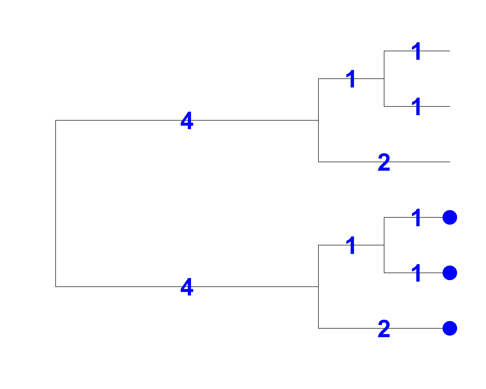{fig-align='center' width=960}
:::
:::


:::

::: {.column width="50%"}
- Total branch length = 9
:::
:::

---

## Faith's Index (PD)

::: footer
[1] Faith 1992, Biological Conservation
:::

::: columns
::: {.column width="50%"}


::: {.cell layout-align="center"}
::: {.cell-output-display}
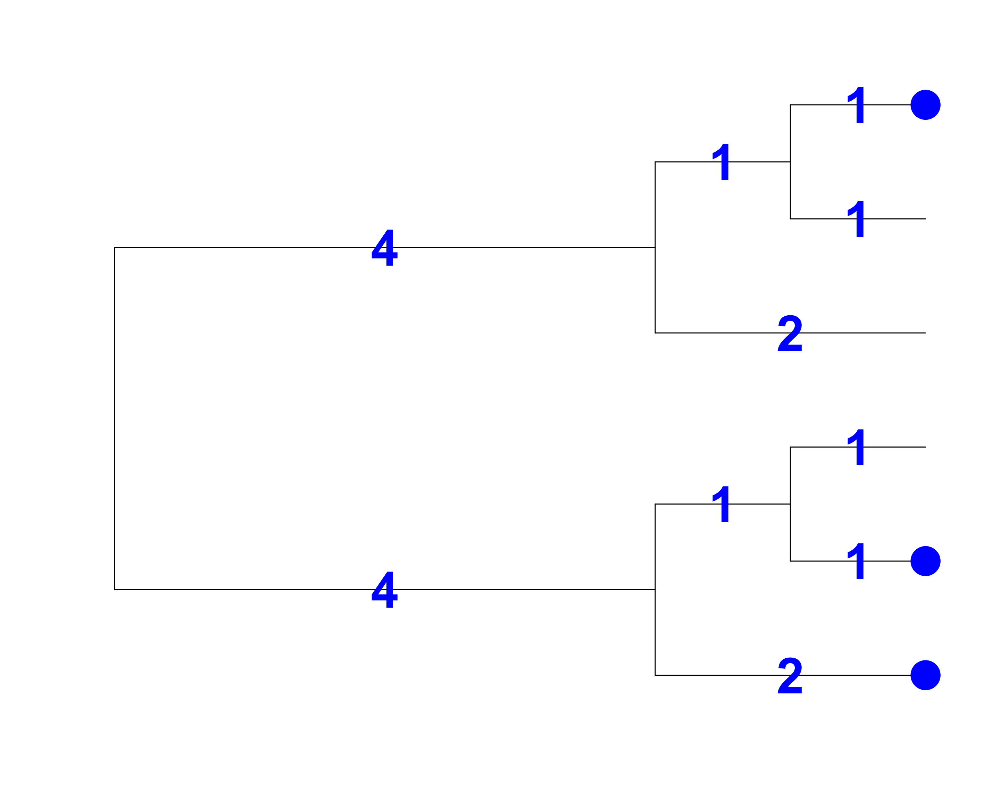{fig-align='center' width=960}
:::
:::

:::

::: {.column width="50%"}
- Total branch length = 14
:::

:::

---

## Beyond Faith's Index (PD)

::: footer
[1] Webb 2000, The American Naturalist
:::

- Solution for genus:species = Use phylogenetic trees to estimate the
  relatedness of coexisting species

    - This solution was first proposed by Cam Webb in 2000


::: columns
::: {.column width="50%"}

::: {.cell layout-align="center"}
::: {.cell-output-display}
{fig-align='center' width=384}
:::
:::

:::

::: {.column width="50%"}
::: fragment

**Distance matrix**


::: {.cell layout-align="center"}
::: {.cell-output .cell-output-stdout}

```
    A B C D E
  B 1        
  C 2 2      
  D 4 4 3    
  E 5 5 4 2  
  F 5 5 4 2 1
```


:::
:::


:::
:::
:::

---

## Mean Pairwise Distance (MPD){.small}


::: footer
[1] $MPD = \frac{2}{n(n-1)} \sum_{i<j} \delta_{i,j}$, where
$\delta_{i, j}$ is the pairwise distance between species *i* and *j*
:::

Let's consider greatest possible mean pairwise node distance (MPD) for a community of 4 taxa

::: columns
::: {.column width="50%"}

::: {.cell layout-align="center"}
::: {.cell-output-display}
{fig-align='center' width=384}
:::
:::

:::

::: {.column width="50%"}

::: {.cell layout-align="center"}
::: {.cell-output .cell-output-stdout}

```
    A B C D E
  B 1        
  C 2 2      
  D 4 4 3    
  E 5 5 4 2  
  F 5 5 4 2 1
```


:::
:::

:::

:::


::: fragment

::: {.cell layout-align="center"}
::: {.cell-output .cell-output-stdout}

```
    A B E
  B 1    
  E 5 5  
  F 5 5 1
```


:::
:::


Greatest MPD for a community of 4 taxa: 22 / 6 pairs = 3.67 (A, B, E, F)
:::

---

## Mean Pairwise Distance (MPD){.small}


::: footer
[1] $MPD = \frac{2}{n(n-1)} \sum_{i<j} \delta_{i,j}$, where
$\delta_{i, j}$ is the pairwise distance between species *i* and *j*
:::

Greatest possible mean pairwise node distance for a community of 4 taxa: 22 / 6 pairs = 3.67 (A, B, E, F)

::: columns
::: {.column width="50%"}
Community 1; A, B, C, D


::: {.cell layout-align="center"}
::: {.cell-output .cell-output-stdout}

```
    A B C
  B 1    
  C 2 2  
  D 4 4 3
```


:::
:::


**MPD** = (1 + 2 + 2 + 4 + 4 + 3) / 6 = 2.67

1 − MPD / MPD<sub>max</sub> = 1 − (2.67 / 3.67) = 0.273
:::

::: {.column width="50%"}

Community 2; A, B, E, F


::: {.cell layout-align="center"}
::: {.cell-output .cell-output-stdout}

```
    A B E
  B 1    
  E 5 5  
  F 5 5 1
```


:::
:::


**MPD** = (1 + 5 + 5 + 5 + 5 + 1) / 6 = 3.67

1 − MPD / MPD<sub>max</sub> = 1 − (3.67 / 3.67) = 0

:::

:::

::: fragment
::: large
Community 1 is more phylogenetically similar.
:::
:::

::: {style="font-size:0.55em;"}
Simplified relative index for illustration. Standard NRI = −(MPD<sub>obs</sub> − mean MPD<sub>null</sub>) / sd MPD<sub>null</sub> (= −ses.mpd in picante)
:::

::: notes
The expression "1 − MPD / maximum MPD" is a relative index used for illustration, not the standard NRI. NRI is standardized against null communities with the same number of randomly sampled species. It is the negative of ses.mpd used in the R practical.

:::
---

## Mean Nearest Taxon Distance (MNTD){.small}

::: footer
[1] $MNTD = \frac{1}{n} \sum^n_i min \delta_{i,j} \; i \neq j$, where $min \delta_{i, j}$ is the minimum distance between species *i* and all other species in the community.
:::

Greatest possible nearest nodal distance for a community of 4 taxa = 2 (A, C, D, F; A to C = 2, D to F = 2)

::: columns
::: {.column width="50%"}

::: {.cell layout-align="center"}
::: {.cell-output-display}
{fig-align='center' width=384}
:::
:::

:::

::: {.column width="50%"}

::: {.cell layout-align="center"}
::: {.cell-output .cell-output-stdout}

```
    A B C D E
  B 1        
  C 2 2      
  D 4 4 3    
  E 5 5 4 2  
  F 5 5 4 2 1
```


:::
:::

:::

:::

---

## Mean Nearest Taxon Distance (MNTD){.small}

::: footer
[1] $MNTD = \frac{1}{n} \sum^n_i min \delta_{i,j} \; i \neq j$, where $min \delta_{i, j}$ is the minimum distance between species *i* and all other species in the community.
:::


::: {.cell layout-align="center"}

:::


::: columns
::: {.column width="50%"}
Community 1; A, B, C, D


::: small
- A -> B
- B -> A
- C -> (A, B)
- D -> C
:::


::: {.cell layout-align="center"}
::: {.cell-output .cell-output-stdout}

```
    A B C
  B 1    
  C 2 2  
  D 4 4 3
```


:::
:::


**MNTD** = (1 + 1 + 2 + 3) / 4 = 1.75

1 − MNTD / MNTD<sub>max</sub> = 1 − (1.75 / 2.0) = 0.125
:::

::: {.column width="50%"}

Community 2; A, B, E, F

::: small
- A -> B
- B -> A
- E -> F
- F -> E
:::


::: {.cell layout-align="center"}
::: {.cell-output .cell-output-stdout}

```
    A B E
  B 1    
  E 5 5  
  F 5 5 1
```


:::
:::


**MNTD** = (1 + 1 + 1 + 1) / 4 = 1

1 − MNTD / MNTD<sub>max</sub> = 1 − (1 / 2.0) = 0.5

:::

:::

::: fragment
::: large
Community 2 is more phylogenetically similar (in tips).
:::
:::

::: {style="font-size:0.55em;"}
Simplified relative index for illustration. Standard NTI = −(MNTD<sub>obs</sub> − mean MNTD<sub>null</sub>) / sd MNTD<sub>null</sub> (= −ses.mntd in picante)
:::

::: notes
MPD is more sensitive to the overall tree topology, while MNTD is more sensitive to the tip of the tree.

The expression "1 − MNTD / maximum MNTD" is a relative index used for illustration, not the standard NTI. NTI is the negative of ses.mntd used in the R practical.

:::
---

## Sparks community phylogeny

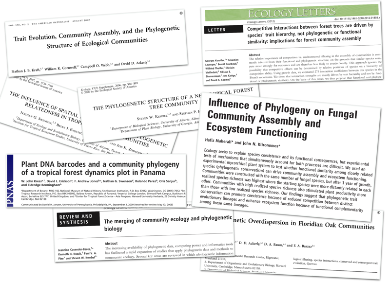

::: notes
break?

:::
---

## Putting traits on the tips of phylogeny: phylogenetic signal{.small}

::: footer
[1] Blomberg et al. 2003, Evolution
:::

::: columns
::: {.column width="30%"}

:::

::: {.column width="70%"}
::: incremental

-	What is Phylogenetic Signal (K)?
    -	Phylogenetic signal measures the degree to which related species share similar traits, quantifying the inheritance of traits from either recent or more ancient common ancestors.
    - Pagel's $\lambda$ is another common measure.
-	Interpretation of K Values:
    -	**Large K** (phylogenetic conservatism): Trait similarity is high among closely related species, suggesting that traits are conserved across lineages.
    - **K = 1**: Traits are evolving under Brownian motion.
    -	**Small K** (phylogenetic divergence): Trait similarity is low among closely related species, indicating that traits have diverged.
-	Calculating K:
    -	K is the ratio of the Mean Squared Error (MSE) of observed trait values to the MSE expected under Brownian motion (random evolutionary change).

:::

:::
:::

::: notes
Short explanation

:::
---

## Phylogenetic conservatism matters

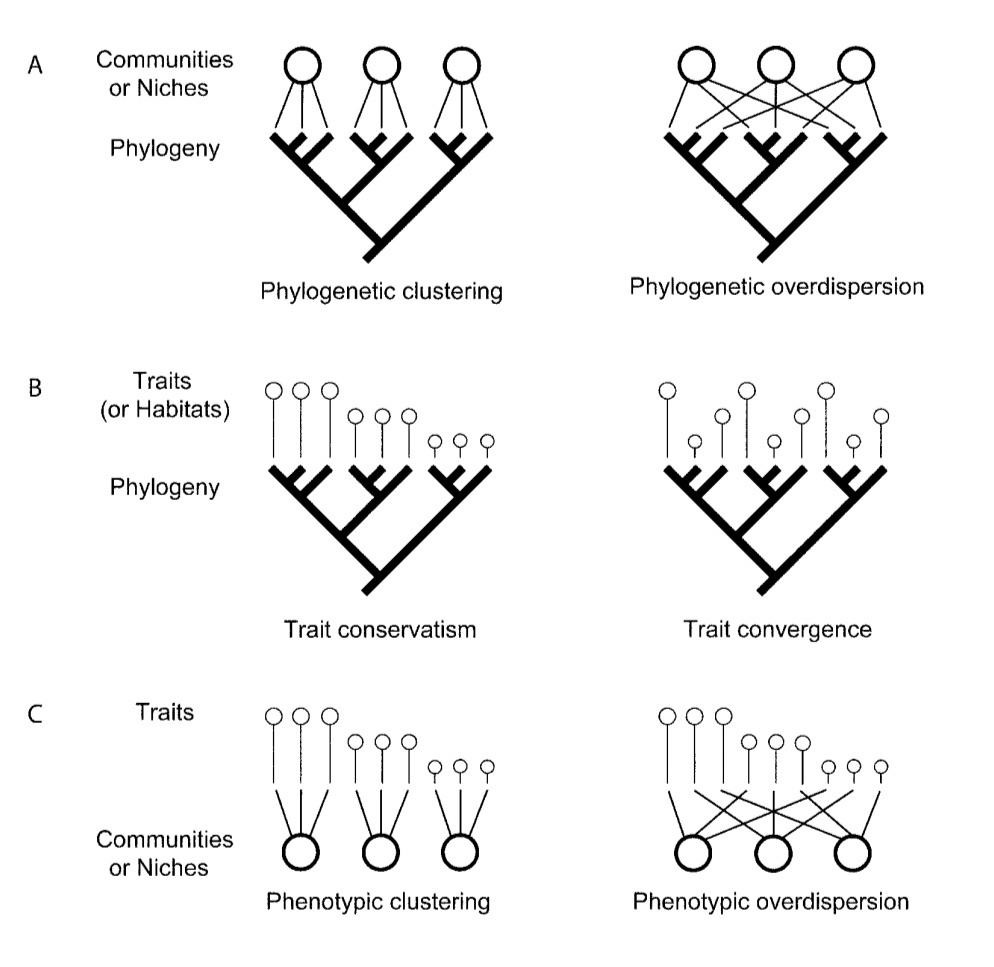

::: footer
[1] Cavender-Bares et al. 2004, The American Naturalist
:::

---

## Phylogenetic conservatism matters

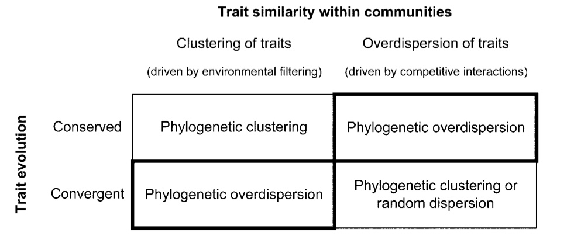

::: footer
[1] Cavender-Bares et al. 2004, The American Naturalist
:::

---

## Rebuilding community ecology from functional traits

::: footer
[1] McGill et al. 2006, Trends in Ecology and Evolution
:::

::: incremental
- Go beyond 'How many species and why?' to ask '**How much variation in traits and why?**'
- Go beyond 'In what environments does a species occur?’ to ask '**What traits and environmental variables are most important in determining fundamental niche?**'
- Go beyond 'What are the most important niche dimensions?' to ask '**What traits are most decisive in translating from fundamental niche to realized niche?**'
- Go beyond 'How does population dynamics determine abundance?' to ask '**How does the performance of species in the interaction milieu determine their ranking of abundance or biomass?**'
- Go beyond 'How does space affect population dynamics?' to ask '**How do environmental gradients affect community structuring?**'
:::

---

## Environmental filtering can occur within dipterocarp trees{.small}

::: footer
[1] Katabuchi et al. 2012, Journal of Ecology
:::

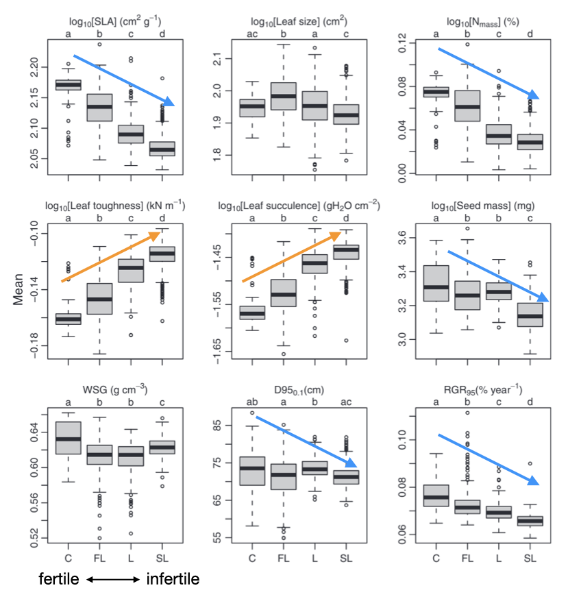

<!-- ::: columns
::: {.column width=40%}
:::

::: {.column width=60%}
:::
::: -->

---

## Facilitation


::: footer
[1] López-Angulo et al. 2018, Journal of Vegetation Science
:::

::: columns
::: {.column width=40%}
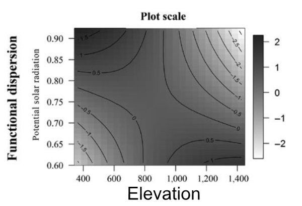
:::

::: {.column width=60%}
::: incremental

- Alpine plants in the Andes

- Functional dispersion in harsh environments (higher potential solar radiation)

- Facilitation tends to dominate interactions when environmental harshness increases

:::
:::
:::

---

## Can normalization create correlations with LMA?

::: columns
::: {.column width="60%"}
::: {style="font-size:0.7em;"}
**1. Mass normalization**

$$
A_{\mathrm{mass}}=\frac{A_{\mathrm{area}}}{LMA}
$$

$$
\log A_{\mathrm{mass}}=\log A_{\mathrm{area}}-\log LMA
$$

**2. Covariance with LMA**

**General identity:**

$$
\begin{aligned}
&\mathrm{Cov}(\log A_{\mathrm{mass}},\log LMA)\\
&=\mathrm{Cov}(\log A_{\mathrm{area}},\log LMA)\\
&\quad-\mathrm{Var}(\log LMA)
\end{aligned}
$$

**If log area-based photosynthesis is uncorrelated with log LMA:**
:::

::: {style="font-size:0.95em;"}
$$
\boxed{
\begin{aligned}
&\mathrm{Cov}(\log A_{\mathrm{mass}},\log LMA)\\
&=-\mathrm{Var}(\log LMA)
\end{aligned}
}
$$
:::
:::

::: {.column width="40%"}
::: small
- **Area-based photosynthesis** is converted to mass-based photosynthesis by dividing by LMA.
- This introduces a shared mathematical dependence on LMA.
- Even if area-based photosynthesis is uncorrelated with LMA (on log scale), **mass-based photosynthesis will be negatively correlated with LMA**.

**Key takeaway:**

A negative relationship between mass-based photosynthesis and LMA does not necessarily indicate a biological trade-off.
:::

::: {style="font-size:0.55em;"}
*The general identity holds without this assumption.*
:::
:::
:::

::: footer
Osnas et al. (2013), Science. doi:10.1126/science.1231574
:::

