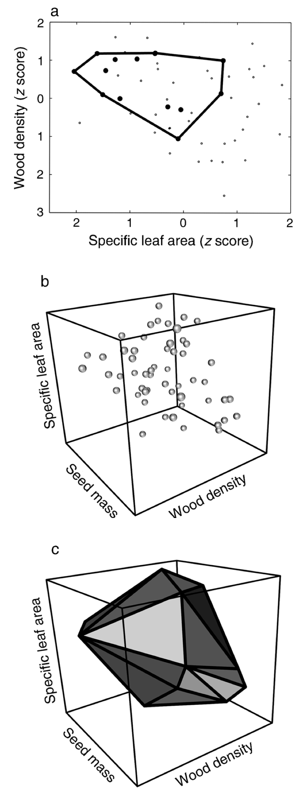

```{r external, child="setup.Rmd", include=FALSE}
```

##  {#title-slide background="images/tree_bg.png" background-size="40%"}

::: title-box
<h2>

`r rmarkdown::metadata$pagetitle`

</h2>

<h3>
🧑🏻‍💻 [`r rmarkdown::metadata$author` \@ `r rmarkdown::metadata$institute`]{.author}


`r rotating_text(c('<i class="fa-solid fa-envelope"></i> mattocci27@gmail.com', '<i class="fa-brands fa-bluesky"></i> <a href="https://bsky.app/profile/mattocci.bsky.social">mattocci.bsky.social</a>', '<i class="fa-brands fa-github"></i> github.com/mattocci27/phy-fun-div', '<i class="fa-solid fa-globe"></i> https://mattocci27.github.io'))`
</h3>
:::


<br><br>

::: {.absolute .top-0 .w-100}
[`r rmarkdown::metadata$date`]{.fl} [`r rmarkdown::metadata$host`]{.fr}
:::


::: notes
hoge
:::

---

## Objective

::: large
We Learn:

- Why we use functional and phylogenetic diversity

- How to calculate functional and phylogenetic diversity

- Trait-based approaches
:::

<!--  -->

---

## Outline

::: large
- Community Ecology

- Simple diversity indices

- Phylogenetic diversity

- Functional traits and diversity

- R examples
:::

---

## Community Assembly and Species Coexistence

For over a century, field ecologists have been characterizing patterns in ecological communities and trying to draw theoretical inferences from the resulting data.


---

## Central Questions:

::: columns
::: {.column width="50%"}
::: small
- Why do species occur in specific locations?

- Why do some species coexist while others do not?

::: incremental

- **Environmental filtering**:
  - [**Ecologically similar**]{.blue} species should coexist in ecologically similar environments.
- **Limiting similarity**:
  - [**Ecologically dissimilar**]{.orange} species should coexist because too similar species competing for the same resources cannot stably coexist.
- **Neutral theory**:
  - Dispersal and stochastic demographic processes explain species coexistence and species differences are not important.

:::
:::
:::

::: {.column width="50%"}

:::
:::


::: footer
Russo et al. 2005, Journal of Ecology.
:::

---

## How can we quantify ecological similarity of coexisting species?

---

## How to quantify ecological communities 🍃


::: large
::: incremental

- Species

- Species + Site information (1950s ~)

- Species + Site information + Species information (2000s ~)

:::
:::

---

## 1a) First-order properties of single communities

::: footer
[1] Vellend, M. (2016). The Theory of Ecological Communities. Princeton University Press
:::


::: columns
::: {.column width="50%"}
- A **vector** of species abundance

- Species composition

```{r, echo=FALSE}
ab1 <- c(4, 300, 56, 23) |> as.matrix()
rownames(ab1) <- paste0("Sp. ", 1:4)
colnames(ab1) <- "Site1"
ab1 |>
  knitr::kable(format = "html") |>
  kable_material(c("striped", "hover"), font_size = 28, full_width = FALSE)
```

```{r, echo=FALSE, fig.retina=3, fig.height=3, fig.width=6}
ggplot(ab1 |> as.data.frame(), aes(x = rank(-ab1), y = ab1)) +
  geom_point(size = 5) +
  geom_line() +
  xlab("Abundance rank") +
  ylab("Abundance") +
  ggtitle("Species abundance distribution") +
  theme(
    axis.title        = element_text(size = 24),
    axis.text         = element_text(size = 24),
    plot.title = element_text(size = 24))
```

:::

::: {.column width="50%"}
::: fragment
- Species richness = 4
:::

::: fragment
- Simpson's evenness = 1/ Σfreq<sub>i</sub><sup>2</sup> = (4/383)<sup>2</sup> + (300/383)<sup>2</sup> + (56/383)<sup>2</sup> + (23/383)<sup>2</sup>
:::

:::

:::

---

## 1a) First-order properties of single communities

::: footer
[1] Vellend, M. (2016). The Theory of Ecological Communities. Princeton University Press
:::

Which community is more diverse?


::: columns
::: {.column width="50%"}
::: fragment
- Species richness = 2

- What is the chance to get the same species?
:::
:::

::: {.column width="50%"}
::: fragment
- A: $\frac{9}{10} \times \frac{8}{9} + \frac{1}{10} \times \frac{0}{9} = 0.8$

- B: $\frac{5}{10} \times \frac{4}{9} + \frac{5}{10} \times \frac{4}{9}  \simeq 0.44$
:::
:::
:::

---

## 1a) First-order properties of single communities

::: columns
::: {.column width="50%"}
Which community is more diverse?


- A: $\frac{9}{10} \times \frac{8}{9} + \frac{1}{10} \times \frac{0}{9} = 0.8$


- B: $\frac{5}{10} \times \frac{4}{9} + \frac{5}{10} \times \frac{4}{9}  \simeq 0.44$

- We prefer that large values indicate more diverse communities.
:::

::: {.column width="50%"}
::: fragment
- Diversity of A: 1 - 0.8 = 0.2

- Diversity of B: 1 - 0.44 = 0.56
:::
::: fragment
- Simpson's Index of Diversity:
  $D = 1 - \Sigma\frac{n_i(n_i - 1)}{N_i(N_i - 1)}$


- Simpson's Index of Diversity (ver. 2):
  $D = 1 - \Sigma p_i^2$
:::
:::
:::

::: footer
*n*: number of individuals of each species,
*N*: total number of individuals of all species,
*p*: relative species abundance

[1] Vellend, M. (2016). The Theory of Ecological Communities. Princeton University Press
:::

---

## 1a) First-order properties of single communities


::: columns
::: {.column width="45%"}
Another simple way to describe diversity?


::: incremental
::: small
- A: $p_1$ = 0.9, $p_2$ = 0.1

- B: $p_1$ = 0.5, $p_2$ = 0.5

- Diversity of A: 0.9 $\times$ 0.1 = 0.09?

- Diversity of B: 0.5 $\times$ 0.5 = 0.25?

- Diversity $\times$ Diversity? What is the unit?

:::
:::
:::

::: {.column width="55%"}
::: small
::: fragment
- $\mathrm{log}(x \times y) = \mathrm{log}(x) + \mathrm{log}(y)$
:::

::: fragment
- Expectations:
  - A: $0.9 \times \mathrm{log}(0.9) + 0.1 \times \mathrm{log}(0.1) \simeq -0.32$
  - B: $0.5 \times \mathrm{log}(0.5) + 0.5 \times \mathrm{log}(0.5) \simeq -0.69$
:::

::: fragment
- We prefer that large values indicate more diverse communities.
  - A: $-1 \times (-0.32) = 0.32$
  - B: $-1 \times (-0.69) = 0.69$
:::
::: fragment
- Shannon Diversity Index: $H' = -\Sigma p_i\mathrm{log}p_i$
:::
:::
:::
:::

::: footer
*p*: relative species abundance

[1] Vellend, M. (2016). The Theory of Ecological Communities. Princeton University Press
:::


::: notes

- If we use log, multiplication becomes an addition.

- Expectations to get a particular species (abundance weighted)

- The mathematical theory of communication (0 or 1 data)

:::

---

## 1b) First-order properties of multiple communities (Beta diversity){.small}

::: footer
[1] Vellend, M. (2016). The Theory of Ecological Communities. Princeton University Press
:::

::: columns
::: {.column width="50%"}
- Species $\times$ site **matrix**
- Metacommunity

```{r, echo=FALSE}
ab <- cbind(c(4, 300, 56, 23),
            c(0, 250, 120, 18),
            c(315, 0, 74, 101),
            c(23, 18, 0, 0))
rownames(ab) <- paste("Sp.", 1:4)
colnames(ab) <- paste("Site", 1:4)
ab %>%
  knitr::kable(format = "html") |>
  # kable_material(c("striped", "hover"), font_size = 32)
  kable_material(c("striped", "hover"))
```
:::
::: {.column width="50%"}
::: fragment
- Dissimilarity matrix (site $\times$ site)

```{r, echo=FALSE}
library(vegan)

vegdist(t(ab), method = "bray") %>%
  as.matrix %>%
  round(2) %>%
  knitr::kable(format = "html") |>
  # kable_material(c("striped", "hover"), font_size = 32)
  kable_material(c("striped", "hover"))
```
e.g., Bray–Curtis dissimilarity

$BC_{ij}=1-2\frac{\sum min\left(S_{A,i}\mbox{, } S_{B,i}\right)}{\sum S_{A,i}+\sum S_{B,i}}$

Site 1 vs Site 2:  1 - (2 * (0 + 250 + 56 + 18) / (4 +300 + 56 + 23 + 0 + 250 + 120 + 18)) = 0.16
:::
:::
:::

---

## 2a) Second-Order properties with site characteristics (1950s ~){.small}

::: footer
[1] Vellend, M. (2016). The Theory of Ecological Communities. Princeton University Press
:::

::: columns
::: {.column width="50%"}

```{r, include=FALSE}
env <- rbind(c(780, 2500, 480, 1200),
            c(21, 11, 24, 19),
            c(1500, 1900, 700, 4500))
rownames(env) <- paste("Env.", 1:3)
colnames(env) <- paste("Site", 1:4)
```

```{r, echo=FALSE}
rownames(env) <- c("Elevation (m)", "MAT (\U2103)", "MAP (mm)")

rbind(ab, env) |>
  kbl(booktabs = TRUE, escape = FALSE, format = "html") |>
  kable_material(c("striped", "hover"), font_size = 32) |>
  pack_rows("Abundance", 1, 4) |>
  pack_rows("Env", 5, 7)
```

:::
::: {.column width="50%"}
- "Species $\times$ site" and "site $\times$ environment"


::: fragment
- Diversity-environment relationships
:::

::: fragment
- Composition-environment relationships
    - Multivariate ordination: placing the survey plots "in order" based on their multivariate species composition.
:::
:::

:::

::: notes
E.g., Sp. 1 may prefer higher temperature with lower rainfall.
:::

---

## 2b) Second-Order properties with species characteristics (2000s ~){.small}

::: footer
[1] Vellend, M. (2016). The Theory of Ecological Communities. Princeton University Press
:::

::: columns
::: {.column width="50%"}

```{r, echo=FALSE}
rbind(ab, env) |>
  kbl(booktabs = TRUE, escape = FALSE, format = "html") |>
  kable_material(c("striped", "hover"), font_size = 32) |>
  pack_rows("Abundance", 1, 4) |>
  pack_rows("Env", 5, 7)
```

:::
::: {.column width="50%"}

```{r, include=FALSE}
set.seed(123)
trait <- cbind(rlnorm(4, log(2), 0.8),
               rlnorm(4, 1.5, 0.6),
               rlnorm(4, 1, 0.6),
               rlnorm(4, 3)) |> round(1)

rownames(trait) <- paste("Sp", 1:4)
colnames(trait) <- paste("Trait", 1:4)
```

```{r, echo=FALSE}
colnames(trait) <- c("Leaf N", "Amax", "Rdark", "LL")

trait %>%
  knitr::kable(format = "html") |>
  kable_material(c("striped", "hover"), font_size = 32)
```

- "Trait $\times$ species", "species $\times$ site", "site $\times$ environment"

::: fragment
- Trait diversity and its role in species composition

- Trait composition-environment relationships
:::
:::
:::

---

## How to measure species characteristics?

::: columns
::: {.column width="30%"}
Photosynthetic rates


:::

::: {.column width="70%"}
::: fragment

:::
:::

:::

---

## Assuming closely related species are more ecologically similar{.small}

-  Genus:species ratio: Relatedness as a substitute for ecological similarity

::: fragment
::: columns
::: {.column width="50%"}
Community with 1 genus and 3 species (1:3)


:::

::: {.column width="50%"}
Community with 3 genus and 3 species (3:3)


:::
:::
:::

::: incremental
- A [**low**]{.blue} genus:species ratio indicates closely related species coexist.

   - [**Environmental filtering**]{.blue}

- A [**high**]{.orange} genus:species ratio indicates distantly related species coexist.

  - [**Limiting similarity**]{.orange}

:::

::: notes
Species that I collected
:::

---

## Assuming closely related species are more ecologically similar{.small}

-  Genus:species ratio: Relatedness as a substitute for ecological similarity

::: columns
::: {.column width="50%"}
Community with 3 genus and 3 species (3:3)


:::

::: {.column width="50%"}
Community with 3 genus and 3 species (3:3)


:::
:::

- A [**low**]{.blue} genus:species ratio indicates closely related species coexist.

   - [**Environmental filtering?**]{.blue}

- A [**high**]{.orange} genus:species ratio indicates distantly related species coexist.

  - [**Limiting similarity?**]{.orange}

::: notes
- Macaranga: Euphorbiaceae
- Artocarups: Moraceae
- Ilex: Aquifoliaceae
:::

::: notes
属によって分岐年代が異なるため、同じ属／種比でも進化的距離は同じとは限らない。歴史的な説明は補足へ。
:::

---

## Solution for the genus:species ratio problem = Use phylogenetic trees{.small}

```{r, echo=FALSE}
aa <- c(1, 3, 5, 9, 11, 13)
#aa <- c(1, 2, 3, 5, 6, 6)
#aa <- 1:3
#names(aa) <- LETTERS[1:6]
names(aa) <- c("E", "D", "F", "B", "A", "C")

t <- aa %>%
  dist %>%
  hclust %>%
  as.phylo

t0 <- aa %>%
  dist %>%
  hclust

plot(t,
   show.tip.label = FALSE,
   direction = "downward",
   main = "Phylogeny")
```

---

## Phylodiversity

::: footer
[1] Dimensions of Biodiversity, NSF
:::

::: columns
::: {.column width="50%"}

:::

::: {.column width="50%"}
- In the 1990's conservation biologists recognized the *biodiversity* is not only species diversity

    - Biodiversity has several axes or dimensions including genetic, taxonomic, phylogenetic and functional diversity
:::
:::

---

## Phylodiversity

::: footer
[1] Faith 1992, Biological Conservation
:::

::: incremental
- Phylogenetic diversity was first formalized by Dan Faith in 1992
- He proposed a metric called PD that is also commonly referred to as Faith's
  Index
- Many additional metrics have now been generated but this metric is still
  widely used, especially in the context of conservation
:::

---

## Faith's Index (PD)

::: footer
[1] Faith 1992, Biological Conservation
:::

::: columns
::: {.column width="50%"}

```{r, echo=FALSE, fig.height = 8}
my_samp <- rep(1, 6) %>% as.matrix %>% t
colnames(my_samp) <- names(aa)
rownames(my_samp) <- "site1"
total_pd <- pd(my_samp, t)[1,1]

plot(t,
   show.tip.label = FALSE,
   direction = "rightwards")

edgelabels(t$edge.length,
           frame = "none",
           bg = "white",
           cex = 3,
           col = "blue",
           font = 2)
```

- Total branch length = `r total_pd`

:::


::: {.column width="50%"}

::: fragment
- PD is the sum of the lengths of all those branches that are members of the corresponding minimum spanning path
:::

::: fragment
- PD is the phylogenetic analogue of taxon richness and is expressed as the number of tree units which are found in a sample
:::

::: fragment
- PD will correlate with species richness
:::

:::
:::

---

## Same species richness, different phylogenetic diversity

::: columns
::: {.column width="50%"}
Three closely related species

```{r pd-comparison-clustered, echo=FALSE, fig.height=5}
pd_clustered <- my_samp
pd_clustered[, 4:6] <- 0
plot(t, show.tip.label = TRUE, direction = "rightwards")
edgelabels(t$edge.length, frame = "none", bg = "white",
           cex = 3, col = "blue", font = 2)
tiplabels(pch = 21, cex = 3, col = NA,
          bg = ifelse(pd_clustered[1, ] > 0, "blue", NA))
```

PD = `r pd(pd_clustered, t)[1, 1]`
:::
::: {.column width="50%"}
Three species spread across the tree

```{r pd-comparison-spread, echo=FALSE, fig.height=5}
pd_spread <- my_samp
pd_spread[, c(2, 4, 6)] <- 0
plot(t, show.tip.label = TRUE, direction = "rightwards")
edgelabels(t$edge.length, frame = "none", bg = "white",
           cex = 3, col = "blue", font = 2)
tiplabels(pch = 21, cex = 3, col = NA,
          bg = ifelse(pd_spread[1, ] > 0, "blue", NA))
```

PD = `r pd(pd_spread, t)[1, 1]`
:::
:::

::: footer
Faith 1992, Biological Conservation
:::

::: notes
種数は同じでも、選ばれた種を結ぶ枝の合計は異なる。個別の枝長を足す手順は補足に残した。
:::

---

## PD, MPD and MNTD: what do we measure?

::: columns
::: {.column width="45%"}
```{r phylogenetic-distances-overview, echo=FALSE, fig.height=5}
plot(t, show.tip.label = TRUE, direction = "rightwards", cex = 1.5)
edgelabels(t$edge.length, frame = "none", bg = "white",
           cex = 2, col = "blue", font = 2)

overview_distances <- cophenetic(t)
overview_metrics <- function(species) {
  distances <- overview_distances[species, species]
  mean_pairwise <- mean(distances[lower.tri(distances)])
  diag(distances) <- Inf
  sample <- matrix(as.numeric(t$tip.label %in% species), nrow = 1,
                   dimnames = list(NULL, t$tip.label))
  c(PD = pd(sample, t)[1, 1],
    MPD = mean_pairwise, MNTD = mean(apply(distances, 1, min)))
}
overview_abcd <- overview_metrics(c("A", "B", "C", "D"))
overview_abde <- overview_metrics(c("A", "B", "D", "E"))
```
:::
::: {.column width="55%"}
::: small
- **PD:** sum the connecting branches, counting each branch once.
- **MPD (Mean Pairwise Distance):** average the path lengths over all species pairs.
- **MNTD (Mean Nearest Taxon Distance):** average the distance to each species' nearest neighbor.

::: fragment
**Example:** A–B = 1 + 1 = 2; A–C = 1 + 1 + 2 = 4.

MPD includes both pairs. For A's contribution to MNTD, only its nearest neighbor B counts.
:::
:::
:::
:::

::: footer
Faith 1992; Webb 2000
:::

::: notes
PDは共有する枝を一度だけ数える総量。MPDとMNTDは種間の経路長の平均で、PDを種数で割った値ではない。左の枝長をたどり、A–BとA–Cを確認する。MNTDの説明はAについての寄与であり、群集全体では各種について最近隣距離を求めて平均する。
:::

---

## Same richness, different aspects of community structure

| Community | PD | MPD | MNTD |
|:----------|---:|----:|-----:|
| A, B, C, D | `r sprintf("%.0f", overview_abcd["PD"])` | `r sprintf("%.2f", overview_abcd["MPD"])` | `r sprintf("%.2f", overview_abcd["MNTD"])` |
| A, B, D, E | `r sprintf("%.0f", overview_abde["PD"])` | `r sprintf("%.2f", overview_abde["MPD"])` | `r sprintf("%.2f", overview_abde["MNTD"])` |

::: small
::: incremental
- **Higher PD in A, B, C, D:** more evolutionary history in total, including the isolated lineage D.
- **Higher MPD in A, B, D, E:** more pairs span the deep split between the A–B and D–E lineages.
- **Lower MNTD in A, B, D, E:** every species has a close relative, forming two pairs within the community.
:::

::: fragment
**A community can contain distant lineages and close relatives at the same time.**
:::
:::

::: footer
Faith 1992; Webb 2000; Tucker et al. 2017, Biological Reviews
:::

::: notes
種数は両群集とも4だが、どの種が共存するかによって進化的歴史の総量、全体の隔たり、近縁種のまとまり方が異なる。
ABCDではDに近い相手がいないためMNTDが高い。ABDEでは全種に距離2の近縁種があるためMNTDが低い一方、深い分岐をまたぐペアは3組から4組へ増え、MPDが高くなる。PDは15から14へ下がる。
生態学的には、群集が系統全体に広がっていることと、各種に近縁の共存種がいることは両立する。したがって「どちらがより多様か」は、保全で進化的歴史の総量を重視するのか、共存種の系統的な隔たりや最近隣の関係を重視するのかで変わる。
これは系統構造の記述であり、この値だけで環境フィルタリングや競争を特定できない。集積・過分散を評価するには種プールと種数などを考慮した帰無モデルとの比較が必要。系統距離をニッチ差として解釈するには形質との対応も必要で、次のAnoleの例につなぐ。
:::

---

## Do phylogenetically related species have similar ecological niches?{.small}

::: footer
[1] Anolis ecomorphs (Wikipedia)
:::


::: columns
::: {.column width="45%"}

:::

::: {.column width="55%"}
::: incremental
- We are assuming that related species are ecologically similar

- Related species sometimes have very different traits and ecological niches (e.g., grass-bush, trunk, trunk-crown, trunk-ground and twig ecomorphs)
:::

:::
:::

::: notes
- the study was done in 1998, but people usually ignore something inconvenient
:::

---

## Functional dendrogram vs. phylogeny (Anole example){.small}

::: footer
[1] Losos et al. 1998, Science
:::

::: columns
::: {.column width="50%"}

:::

::: {.column width="50%"}
::: incremental

- A: Functional dendrogram based on ecomorph

- B: Phylogeny indicates frequent evolution of traits

- They do not match at all (!!)

- Phylogenetically similar = Functional (ecologically) similar??

:::

:::
:::

---

## Phylogenetic signal: does relatedness predict trait similarity?{.small}

::: columns
::: {.column width="30%"}

:::
::: {.column width="70%"}
::: incremental
- Phylogenetic signal describes how trait similarity is associated with relatedness.
- Check the traits relevant to the ecological question before using phylogeny as their proxy.
- Signal can differ among traits; relatedness alone does not establish ecological similarity.
:::
:::
:::

::: footer
Blomberg et al. 2003, Evolution
:::

::: notes
KやPagelのlambdaの定量的な説明は補足。ここでは系統を形質の代理にする前に、その対応を確かめる必要があることを伝える。
:::

---

## The phylogenetic middleman problem

::: footer
[1] Swenson 2013, Ecography
:::


::: columns
::: {.column width=35%}

:::

::: {.column width=65%}
::: incremental
- Phylogeny as a proxy for the functional or ecological similarity of species.

- Measuring trait data and arraying it on the phylogenetic tree to demonstrate phylogenetic signal in function so that their phylogenetically-based inferences could be supported.

- Compared to simply measuring the trait dispersion, this approach is very indirect.

- **This approach should be avoided!** (phylogeny and traits are useful to make meaningful evolutionary inferences)
:::
:::

:::

---

## Plant functional traits

Measurable properties of plants that are indicative of ecological strategies

::: columns
::: {.column width=50%}
"Hard" traits: e.g., Photosynthetic rates


:::

::: {.column width=50%}
"Soft" traits: e.g., LMA (leaf mass per area)


:::
:::

---

## Leaf Economic Spectrum (LES)

::: footer
[1] Reich et al. 1997, PNAS

[2] Wright et al. 2004, Nature
:::

::: columns
::: {.column width=20%}

:::

::: {.column width=80%}
::: incremental
::: small
- LES describes pairwise correlations among a bunch of leaf traits from the global leaf database called GLOPNET
- Global leaf function constrained to a single axis (75 % of the variation in the 6 traits)
- Multidimensional (leaf) functional diversity can be mapped into a one-dimensional index
- Controversial because global among‑species patterns don’t always match within‑species or local patterns
:::
:::
:::
:::

---

## Leaf trait correlations depend on normalization

$$
A_{\mathrm{mass}} = \frac{A_{\mathrm{area}}}{\mathrm{LMA}},
\qquad
N_{\mathrm{mass}} = \frac{N_{\mathrm{area}}}{\mathrm{LMA}}
$$

::: incremental
- Expressing traits per unit mass or per unit area can change their correlations.
- **Example:** if photosynthesis per unit area stays constant while LMA doubles, photosynthesis per unit mass halves.
- A shared denominator, LMA, can strengthen correlations between mass-based traits, even when their area-based values vary independently.
:::

::: fragment
**Ask what generates the correlation before interpreting it as a physiological trade-off.**
:::

::: footer
Osnas et al. 2013, Science · doi:10.1126/science.1231574
:::

::: notes
Source: https://doi.org/10.1126/science.1231574
Aは光合成速度、Nは窒素量。massは単位乾燥質量あたり、areaは単位葉面積あたりを表す。式は単位の変換から成り立つ。
LMAが2倍になる例は、規格化の効果だけを示す仮想例で、実測の処理効果ではない。面積あたりの光合成速度と窒素量に相関がなくても、共通のLMAで割ることで質量あたりの値に相関が生じうる。
LESが無意味という結論ではない。LMAと葉寿命の関係を含め、生物学的な変異と規格化がそれぞれ相関にどう寄与するかを考える。面積基準が常に正しいという話でもない。
:::

---

## Rebuilding community ecology from functional traits

::: footer
[1] McGill et al. 2006, Trends in Ecology and Evolution
:::

::: incremental
- Non-trait based statement

   - *Campanula aparinoides* is found only in infertile habitats.

- Trait-based statement

   - Compact plants with canopy area < 30 cm <sup>2</sup>  and small or absent leaves are restricted to marshes with < 18 $\mu$ g g <sup>-1</sup> soil P.
:::

---

## Petchey & Gaston's functional diversity (FD)

::: columns
::: {.column width="50%"}

:::
::: {.column width="50%"}
::: incremental
- Functional diversity describes differences in species' functional traits.
- Build a **functional dendrogram** from measured trait differences. A phylogeny instead represents shared ancestry.
- **Petchey & Gaston's FD:** total branch length connecting the community's species on the functional dendrogram.
- The branch-summing approach parallels Faith's PD, using trait differences rather than evolutionary history.
:::
:::
:::

::: footer
Petchey & Gaston 2002, Ecology Letters
:::

::: notes
functional diversityは概念の総称で、ここで紹介するFDはその指標の一つ。形質データから種間距離を求め、クラスタリングで樹状図を作る。枝長は進化時間を表さない。続くconvex hullは、樹状図ではなく形質空間の占有範囲でfunctional richnessを測る方法として紹介する。
:::

---

## Convex hull volume (functional richness)


::: footer
[1] Cornwell et al. 2006, Ecology
:::

::: columns
::: {.column width=18%}

:::
::: {.column width=82%}
::: incremental

- California woody-plant communities (43 plots, 54 species, 3 traits)

- Is the trait volume of California woody-plant communities significantly less than expected by chance?
    - **Environmental filtering**

:::
:::
:::

---

## Convex hull volume (functional richness)

::: footer
[1] Cornwell et al. 2006, Ecology
:::

::: columns
::: {.column width=40%}

:::

::: {.column width=60%}
::: incremental

- Species in 40 out of 43 plots occupied less trait space than would be expected by chance

- Consistent with environmental filtering

:::
:::
:::

---

## Community assembly and trait distribution


::: footer
[1] Cornwell & Ackerly 2009, Ecological Monographs
:::


---

## Environmental filtering and limiting similarity can occur at the same time{.small}


::: footer
[1] Kraft et al. 2008, Science
:::

::: columns
::: {.column width=40%}

:::

::: {.column width=60%}
::: incremental

- Yasuni tropical tree communities, 25ha, 625 20m x 20m quadrats, 1089 species!

- Consistent with environmental filtering

- A: Ridgetops have lower than expected SLA and valleys have higher
    - Traits match with environmental conditions

- B: Seed mass shows broader distribution than expected - Limiting similarity

- C: Range of SLA is smaller than expected - Environmental filtering

:::
:::
:::

---

## How ecological processes might influence community assembly{.small}

```{r, echo=FALSE}
tbl <- tribble(~`Process / Factor`, ~Pattern,
  "Environmental filtering", "Clustering",
  "Limiting similarity / Competitive exclusion", "Overdispersion",
  "Competitive hierarchy / directional competition", "Clustering",
  "Herbivores / Parasites / Pathogens", "Overdispersion",
  "Pollinator-mediated competition", "Overdispersion",
  "Nurse plants", "Overdispersion",
  "Pollinator facilitation", "Clustering",
  "Neutral theory", "Random"
)

knitr::kable(tbl) |>
  pack_rows("Biotic factor", 1, 1) |>
  pack_rows("Abiotic factor (competition)", 2, 5) |>
  pack_rows("Abiotic factor (facilitation)", 6, 7) |>
  pack_rows("Stochastic process", 8, 8) |>
  kable_material(c("striped", "hover"), font_size = 30)
```

---

##  Competitive hierarchy


::: footer
[1] $t_A$ and $t_B$ are the functional trait values of species A and B

[2] Kunstler et al. 2012, Ecology Letters
:::

::: columns
::: {.column width=50%}
{width="200px"}

### Limiting similarity

Competitive interaction strengths between species will increase with decreasing niche distance, measured as their absolute traits distance $|t_A - t_B|$
:::

::: {.column width=50%}
{width="200px"}

### Competitive hierarchy

Competitive effects of species A on species B will increase with increasing $t_A - t_B$.
:::

:::

---

## Plant–herbivore interactions


::: footer
[1] Endara et al. 2022, Journal of Ecology
:::

::: columns
::: {.column width=40%}

:::

::: {.column width=60%}
::: incremental

- 6000+ secondary metabolites from nearly 100 species in a diverse Neotropical plant clade across the whole Amazonia

- More differences in their defensive chemistry than expected by chance

- Plant–herbivore interactions promote species diversity
:::
:::
:::

---

## Trait-based ecology: where are we now?


---

## Community averages can mislead without species‑level context{.small}

::: footer
[1] Katabuchi et al. 2017, Ecology

[2] Swenson et al. 2020, Ecological Monographs
:::

::: columns
::: {.column width="55%"}


:::
::: {.column width="45%"}
::: {.small}
- **Study site:** 50-ha forest dynamics plot, Barro Colorado Island, Panama.
- **Community-level pattern:** Increasing CWM wood density appears consistent with a response to drier conditions.
- **Species-level explanation:** Just two species account for ~60% of the temporal CWM shift, suggesting that species-specific processes may drive the apparent community trend.
:::
:::
:::

::: notes
Two of approximately 300 species (~0.7%) account for ~60% of the temporal CWM shift. Species-specific pathogens were suggested as a possible explanation, rather than a community-wide climate response.
:::

---

## Why leaf trait relationships differ within and among species

::: columns
::: {.column width="58%"}


:::
::: {.column width="42%"}
::: {.small}
- **Across species:** Leaf lifespan increases strongly with LMA, whereas area-based photosynthesis shows a weak relationship.
- **Within species:** Area-based photosynthesis increases with LMA in the studied Panama assemblages.
- **Proposed mechanism:** LMA variation reflects different contributions of photosynthetic and structural tissues.
:::
:::
:::

::: footer
Osnas, Katabuchi et al. 2018, PNAS · doi:10.1073/pnas.1803989115
:::

::: notes
Source: https://doi.org/10.1073/pnas.1803989115
GlobalとPanamaでは地理的スケールも異なるため、比較の違いを種内・種間の違いだけに帰さない。
2013年の規格化の話を回収し、同じLMAの変化でも、その中身によって生理的な意味が異なることを示す。
種内の陽葉・陰葉の比較では光合成に関わる質量の変化、広い種間比較では構造的質量の変化がLMA変異に大きく寄与するという仮説を提示し、データはその予測と整合した。すべての種内・種間比較に同じ関係が成立するという主張ではない。
構造的質量は強度や葉寿命に関係する。種平均の相関をそのまま種内の応答に当てはめず、LMAを生む成分を考える必要がある。次に、この考え方を生理予測へ進めた例を紹介する。
:::

---

## Separating LMA components improves physiological prediction

::: columns
::: {.column width="60%"}

:::
::: {.column width="40%"}
::: {.small}
- Bulk LMA combines metabolic and structural components.
- Metabolic mass (LMAₘ) is more strongly associated with photosynthesis and respiration per leaf area.
- Structural mass (LMAₛ) is strongly associated with leaf lifespan.

Separating metabolic and structural components reveals distinct functional relationships obscured by bulk LMA.
:::
:::
:::

::: footer
Katabuchi et al. 2025, Oecologia
:::

::: notes
LMAの総量から、その内訳を表す成分へと進める。生理の予測改善を示す事例として紹介する。
ここでの予測対象は生理であり、共存や侵入増殖率の予測を実証したという意味ではない。Levine et al.の共存予測に向けたprocess-informed metricsと同一視せず、次のスライドで生理から個体群・共存への接続を別の課題として示す。
:::

---

## From physiological prediction to species coexistence

::: columns
::: {.column width="63%"}


<span style="font-size:0.55em;">Conceptual illustration</span>

:::
::: {.column width="37%"}
::: {.small}
- **Traits alone are insufficient** to predict species coexistence.
- Predictive models must link traits and physiology to **demographic rates** and **species interactions**.
- **Invasion growth rates** provide a direct link to coexistence theory.
:::
:::
:::

::: footer
Levine et al. 2024, Trends in Ecology & Evolution
:::

::: notes
概念図であり、予測能力が実際に100%に到達することを意味しない。
LMAを分解して生理予測が改善しても、それだけで種の共存が予測できるわけではない。個体の成長・生存・繁殖と、競争下の個体群増殖へのつながりを考える。
機構を反映する指標を選ぶ際には、何を予測したいかを明確にする。生理、個体群動態、共存は異なる予測対象である。
:::

---

## Summary 🍺

::: incremental
- Why do we use trait and phylogenetic diversity?

  - We want to quantify ecological similarities and biodiversity dimensions.

  - We need to be very careful when we use or develop ways to map multiple dimensions of biodiversity to a few dimensions of diversity.

- Trait-based approaches

  - Moving ecology towards more quantitative and predictive methods.

  - We only focused on a "snapshot" of biodiversity (predicting future biodiversity is another story)

  - Developing more effective metrics may be necessary, beyond simply measuring traits.

- How to calculate trait and phylogenetic diversity anyway?

  - We have some R practice.
:::

---

## About the slides

-  The slides are made using [Quarto](https://quarto.org/) with [Emi Tanaka's](https://github.com/emitanaka/talks) CSS design and [Danyang Dai's](https://github.com/DanyangDai/brownbag_2022_10_11) template.

-  Source code for the slides can be found at [mattocci27/phy-fun-div](https://github.com/mattocci27/phy-fun-div)

---

## Supplementary slides {#supplementary-slides}

::: large
- Historical background and additional examples
- Step-by-step PD, MPD and MNTD calculations
- Phylogenetic signal and additional trait-based questions
:::

::: notes
ここから先は通常の授業では解説しない補足資料。質問への対応や実習時の参照に使う。Simpson・Shannonの導出は本編に残している。
:::

---

## 2a) Second-Order properties with site characteristics (1950s ~){.small}

::: footer
[1] Vellend, M. (2016). The Theory of Ecological Communities. Princeton University Press
:::

::: columns
::: {.column width="50%"}

```{r, echo=FALSE}
env <- rbind(c(780, 2500, 480, 1200),
            c(21, 11, 24, 19),
            c(1500, 1900, 700, 4500))
rownames(env) <- paste("Env.", 1:3)
colnames(env) <- paste("Site", 1:4)

rbind(ab, env) |>
  kbl(booktabs = TRUE, escape = FALSE, format = "html") |>
  kable_material(c("striped", "hover"), font_size = 32) |>
  pack_rows("Abundance", 1, 4) |>
  pack_rows("Env", 5, 7)
```

:::
::: {.column width="50%"}
- "Species $\times$ site" and "site $\times$ environment"
:::
:::

---

## 2b) Second-Order properties with species characteristics (2000s ~){.small}

::: footer
[1] Vellend, M. (2016). The Theory of Ecological Communities. Princeton University Press
:::

::: columns
::: {.column width="50%"}

```{r, echo=FALSE}
rbind(ab, env) |>
  kbl(booktabs = TRUE, escape = FALSE, format = "html") |>
  kable_material(c("striped", "hover"), font_size = 32) |>
  pack_rows("Abundance", 1, 4) |>
  pack_rows("Env", 5, 7)
```

:::
::: {.column width="50%"}

```{r, echo=FALSE}
set.seed(123)
trait <- cbind(rlnorm(4, log(2), 0.8),
               rlnorm(4, 1.5, 0.6),
               rlnorm(4, 1, 0.6),
               rlnorm(4, 3)) |> round(1)

rownames(trait) <- paste("Sp", 1:4)
colnames(trait) <- paste("Trait", 1:4)

trait %>%
  knitr::kable(format = "html") |>
  kable_material(c("striped", "hover"), font_size = 32)
```

- "Trait $\times$ species", "species $\times$ site", "site $\times$ environment"

:::
:::

---

## Genus:species ratio

::: footer
[1] Swenson 2013, Ecography
:::

- The genus:species ratio type of study in plant community ecology started ~1910
  and was popular until 1990's

::: fragment
- A large criticism of genus:species ratio analyses is that they do not take
  account for the different ages of genera and species
    - Two species in a relatively young genus may be expected to be more similar than two species in a relatively old genus.
:::

---

## Faith's Index (PD)

::: footer
[1] Faith 1992, Biological Conservation
:::

::: columns
::: {.column width="50%"}

```{r, echo=FALSE, fig.height = 8}
my_samp1 <- my_samp
my_samp1[, 4:6] <- 0
pd1 <- pd(my_samp1, t)[1,1]

plot(t,
   show.tip.label = FALSE,
   direction = "rightwards")

edgelabels(t$edge.length,
          #  adj = c(0.5, 0.5),
           frame = "none",
           bg = "white",
           col = "blue",
           cex = 3,
           font = 2)

tiplabels(
          pch = 21,
          cex = 4,
          col = NA,
          bg = rep(c("blue", NA), each = 3))
```

:::

::: {.column width="50%"}
- Total branch length = `r pd1`
:::
:::

---

## Faith's Index (PD)

::: footer
[1] Faith 1992, Biological Conservation
:::

::: columns
::: {.column width="50%"}

```{r, echo=FALSE, fig.height=8}
my_samp2 <- my_samp
my_samp2[, c(2, 4, 6)] <- 0
pd2 <- pd(my_samp2, t)[1,1]

plot(t,
   show.tip.label = FALSE,
   direction = "rightwards")

edgelabels(t$edge.length,
          #  adj = c(0.5, -0.5),
           frame = "none",
           bg = "white",
           col = "blue",
           cex = 3,
           font = 2)

tiplabels(
          pch = 21,
          cex = 4,
          col = NA,
          bg = rep(c("blue", NA), 3))
```
:::

::: {.column width="50%"}
- Total branch length = `r pd2`
:::

:::

---

## Beyond Faith's Index (PD)

::: footer
[1] Webb 2000, The American Naturalist
:::

- Solution for genus:species = Use phylogenetic trees to estimate the
  relatedness of coexisting species

    - This solution was first proposed by Cam Webb in 2000


::: columns
::: {.column width="50%"}
```{r com-phylo, fig.width =4, fig.height=4.5}
aa2 <- c(1, 3, 5, 9, 11, 13)
names(aa2) <- c("E", "F", "D", "B", "A", "C")

t2 <- aa2 |>
  dist() |>
  hclust() |>
  as.phylo()

plot(t2,
   show.tip.label = FALSE,
   direction = "rightwards",
   main = "Community phylogeny",
   cex.main = 2
)

tiplabels(t2$tip.label,
          cex = 1.5,
          frame = "none")
```
:::

::: {.column width="50%"}
::: fragment

**Distance matrix**


```{r com-dist}
tmp <- rep(1, 6)
names(tmp) <- LETTERS[1:6]
dist_all <- tmp |> dist()
dist_all[1:15] <- c(1, 2, 4, 5, 5,
                    2, 4, 5, 5,
                    3, 4, 4,
                    2, 2,
                    1)
mat_all <- dist_all |> as.matrix()

dist_all
```

:::
:::
:::

---

## Mean Pairwise Distance (MPD) and Net Related Index (NRI){.small}


::: footer
[1] $MPD = \frac{1}{n} \sum^{n}_{i} \sum^n_j \delta_{i,j} \; i \neq j$, where
$\delta_{i, j}$ is the pairwise distance between species *i* and *j*
:::

Let's consider greatest possible mean pairwise node distance (MPD) for a community of 4 taxa

::: columns
::: {.column width="50%"}
```{r com-phylo, fig.width =4, fig.height=4.5}
```
:::

::: {.column width="50%"}
```{r com-dist}
```
:::

:::


::: fragment
```{r}
dist2 <- mat_all[c("A", "B", "E", "F"), c("A", "B", "E", "F")]  %>% as.dist
dist2
```

Greatest MPD for a community of 4 taxa: 22 / 6 pairs = 3.66 (A, B, E, F)
:::

---

## Mean Pairwise Distance (MPD) and Net Related Index (NRI){.small}


::: footer
[1] $MPD = \frac{1}{n} \sum^{n}_{i} \sum^n_j \delta_{i,j} \; i \neq j$, where
$\delta_{i, j}$ is the pairwise distance between species *i* and *j*
:::

Greatest possible mean pairwise node distance for a community of 4 taxa: 22 / 6 pairs = 3.66 (A, B, E, F)

::: columns
::: {.column width="50%"}
Community 1; A, B, C, D

```{r}
dist1 <- mat_all[LETTERS[1:4], LETTERS[1:4]] %>% as.dist
dist1
```

**MPD** = (1 + 2 + 2 + 4 + 4 + 3) / 6 = 2.66

**NRI** = 1 - (2.66 / 3.66) = 0.273
:::

::: {.column width="50%"}

Community 2; A, B, E, F

```{r}
dist2 <- mat_all[c("A", "B", "E", "F"), c("A", "B", "E", "F")]  %>% as.dist
dist2
```

**MPD** = (1 + 5 + 5 + 5+ 5 + 1) / 6 = 3.66

**NRI** = 1 - (3.66 / 3.66) = 0

:::

:::

::: fragment
::: large
Community 1 is more phylogenetically similar.
:::
:::

---

## Mean Nearest Nodal Distance (MNTD) and Nearest Taxa Index (NTI){.small}

::: footer
[1] $MNTD = \frac{1}{n} \sum^n_i min \delta_{i,j} \; i \neq j$, where $min \delta_{i, j}$ is the minimum distance between species *i* and all other species in the community.
:::

Greatest possible nearest nodal distance for a community of 4 taxa = 2 (A, C, D, F; A to C = 2, D to F = 2)

::: columns
::: {.column width="50%"}
```{r com-phylo, fig.width =4, fig.height=4.5}
```
:::

::: {.column width="50%"}
```{r com-dist}
```
:::

:::

---

## Mean Nearest Nodal Distance (MNTD) and Nearest Taxa Index (NTI){.small}

::: footer
[1] $MNTD = \frac{1}{n} \sum^n_i min \delta_{i,j} \; i \neq j$, where $min \delta_{i, j}$ is the minimum distance between species *i* and all other species in the community.
:::


```{r}
dist3 <- mat_all[c("A", "C", "D", "F"), c("A", "C", "D", "F")]  %>% as.dist
```

::: columns
::: {.column width="50%"}
Community 1; A, B, C, D


::: small
- A -> B
- B -> A
- C -> (A, B)
- D -> C
:::

```{r}
dist1
```

**MNTD** = (1 + 1 + 2 + 3) / 4 = 1.75

**NTI** = 1 - (1.75 / 2.0) = 0.125
:::

::: {.column width="50%"}

Community 2; A, B, E, F

::: small
- A -> B
- B -> A
- E -> F
- F -> E
:::

```{r}
dist2
```

**MNTD** = (1 + 1 + 1 + 1) / 4 = 1

**NTI** = 1 - (1 / 2.0) = 0.5

:::

:::

::: fragment
::: large
Community 2 is more phylogenetically similar (in tips).
:::
:::

::: notes
MPD is more sensitive to the overall tree topology, while MNTD is more sensitive to the tip of the tree.
:::

---

## Sparks community phylogeny


::: notes
break?
:::

---

## Putting traits on the tips of phylogeny: phylogenetic signal{.small}

::: footer
[1] Blomberg et al. 2003, Evolution
:::

::: columns
::: {.column width="30%"}

:::

::: {.column width="70%"}
::: incremental

-	What is Phylogenetic Signal (K)?
    -	Phylogenetic signal measures the degree to which related species share similar traits, quantifying the inheritance of traits from either recent or more ancient common ancestors.
    - Pagel's $\lambda$ is another common measure.
-	Interpretation of K Values:
    -	**Large K** (phylogenetic conservatism): Trait similarity is high among closely related species, suggesting that traits are conserved across lineages.
    - **K = 1**: Traits are evolving under Brownian motion.
    -	**Small K** (phylogenetic divergence): Trait similarity is low among closely related species, indicating that traits have diverged.
-	Calculating K:
    -	K is the ratio of the Mean Squared Error (MSE) of observed trait values to the MSE expected under Brownian motion (random evolutionary change).

:::

:::
:::

::: notes
Short explanation
:::

---

## Phylogenetic conservatism matters


::: footer
[1] Cavender-Bares et al. 2004, The American Naturalist
:::

---

## Phylogenetic conservatism matters


::: footer
[1] Cavender-Bares et al. 2004, The American Naturalist
:::

---

## Rebuilding community ecology from functional traits

::: footer
[1] McGill et al. 2006, Trends in Ecology and Evolution
:::

::: incremental
- Go beyond 'How many species and why?' to ask '**How much variation in traits and why?**'
- Go beyond 'In what environments does a species occur?’ to ask '**What traits and environmental variables are most important in determining fundamental niche?**'
- Go beyond 'What are the most important niche dimensions?' to ask '**What traits are most decisive in translating from fundamental niche to realized niche?**'
- Go beyond 'How does population dynamics determine abundance?' to ask '**How does the performance of species in the interaction milieu determine their ranking of abundance or biomass?**'
- Go beyond 'How does space affect population dynamics?' to ask '**How do environmental gradients affect community structuring?**'
:::

---

## Environmental filtering can occur within dipterocarp trees{.small}

::: footer
[1] Katabuchi et al. 2012, Journal of Ecology
:::


<!-- ::: columns
::: {.column width=40%}
:::

::: {.column width=60%}
:::
::: -->

---

## Facilitation


::: footer
[1] López-Angulo et al. 2018, Journal of Vegetation Science
:::

::: columns
::: {.column width=40%}

:::

::: {.column width=60%}
::: incremental

- Alpine plants in the Andes

- Functional dispersion in harsh environments (higher potential solar radiation)

- Facilitation tends to dominate interactions when environmental harshness increases

:::
:::
:::

---

## Can normalization create correlations with LMA?

::: columns
::: {.column width="60%"}
::: {style="font-size:0.7em;"}
**1. Mass normalization**

$$
A_{\mathrm{mass}}=\frac{A_{\mathrm{area}}}{LMA}
$$

$$
\log A_{\mathrm{mass}}=\log A_{\mathrm{area}}-\log LMA
$$

**2. Covariance with LMA**

**General identity:**

$$
\begin{aligned}
&\mathrm{Cov}(\log A_{\mathrm{mass}},\log LMA)\\
&=\mathrm{Cov}(\log A_{\mathrm{area}},\log LMA)\\
&\quad-\mathrm{Var}(\log LMA)
\end{aligned}
$$

**If area-based photosynthesis is uncorrelated with log LMA:**
:::

::: {style="font-size:0.95em;"}
$$
\boxed{
\begin{aligned}
&\mathrm{Cov}(\log A_{\mathrm{mass}},\log LMA)\\
&=-\mathrm{Var}(\log LMA)
\end{aligned}
}
$$
:::
:::

::: {.column width="40%"}
::: small
- **Area-based photosynthesis** is converted to mass-based photosynthesis by dividing by LMA.
- This introduces a shared mathematical dependence on LMA.
- Even if area-based photosynthesis is uncorrelated with LMA, **mass-based photosynthesis will be negatively correlated with LMA**.

**Key takeaway:**

A negative relationship between mass-based photosynthesis and LMA does not necessarily indicate a biological trade-off.
:::

::: {style="font-size:0.55em;"}
*The simplified result assumes zero covariance between log area-based photosynthesis and log LMA. The general identity holds without this assumption.*
:::
:::
:::

::: footer
Osnas et al. (2013), Science. doi:10.1126/science.1231574
:::
